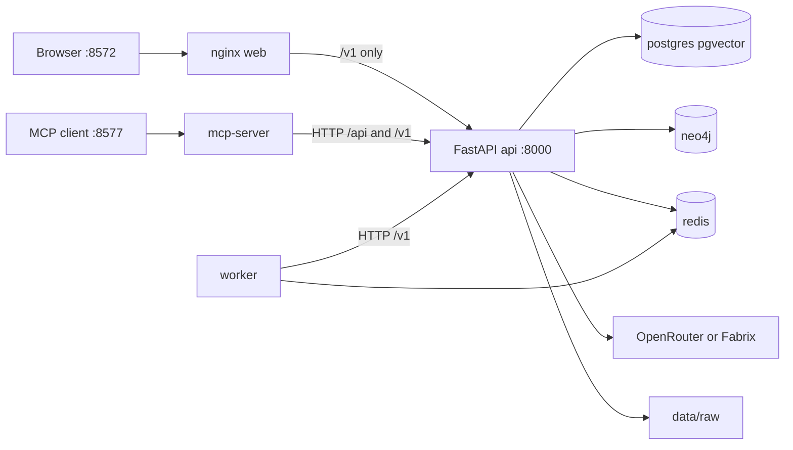
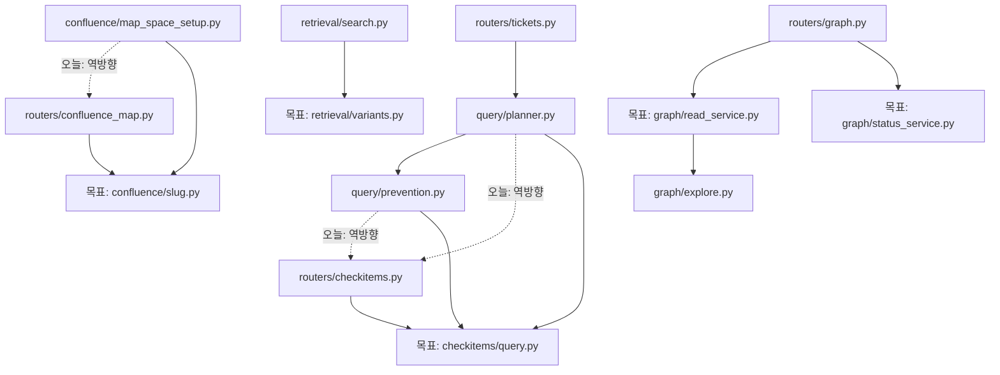
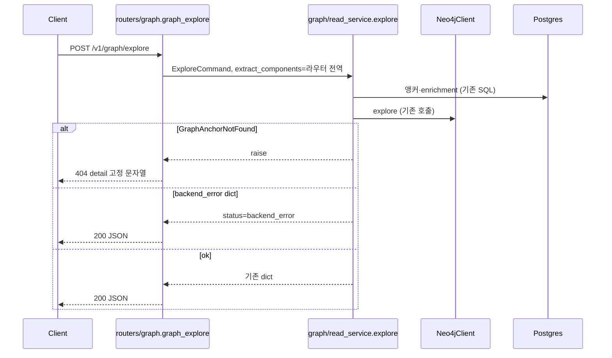

# CI-TEC Knowledge Platform — 조회 경로 계층 리팩토링

| 항목 | 값 |
| --- | --- |
| 문서 | 동작 보존 리팩토링 설계 |
| 작성자 | design-doc-writer |
| 날짜 | 2026-11-12 |
| 상태 | Draft |
| 조사 기준 커밋 | `fe3d619` (2026-11-10, `feat(synonyms): 변형 묶음은 df_max 면제 + reeval 재평가 명령 (#55)`) |
| 저장소 | `/home/citec/dev/citec-kb` |
| 스키마 변경 | 없음 |
| 외부 HTTP/MCP 계약 변경 | 없음 |

## Overview

citec-kb는 FastAPI(`apps/api`) + Redis 잡 워커(`apps/worker`) + MCP 프록시(`mcp-server/server.py`) + nginx 정적 UI(`apps/web`) + Postgres/pgvector + Neo4j로 이루어진 사내 지식 검색·RAG·그래프 플랫폼이다. 도메인 로직의 상당수는 이미 `app/<area>/` 서비스 모듈에 있지만, 조회 핫패스 세 곳이 아직 HTTP 라우터 안에 있고 비-라우터 코드가 그 라우터를 import 한다. 동시에 하이브리드 검색의 FTS 변형 생성(`build_fts_variants`)이 1134라인 SQL 랭킹 모듈 `app/retrieval/search.py` 안에 붙어 있어, 동의어 작업이 랭킹 SQL과 같은 파일을 고쳐야 한다.

이 문서의 채택안은 기능을 더하지 않는다. 라우터에 남은 조회 오케스트레이션을 기존 함수 본문 그대로 서비스 모듈로 옮기고, FTS 변형 생성만 `app/retrieval/variants.py`로 분리하며, MCP는 순수 포맷터만 파일로 뺀다. HTTP 경로, 상태 코드, 에러 `detail` 문자열, MCP 툴 이름, DB 스키마, Redis 잡 타입, 랭킹 수식, 환경변수 의미는 유지한다. 테스트가 라우터 모듈 전역을 monkeypatch 하는 지점은 라우터가 호출 시점에 그 전역을 읽어 서비스에 넘기도록 고정한다.

## Background & Motivation

최근 80커밋(`git log -80 --name-only`, 경로 `apps/api/app` `mcp-server` `packages` `apps/worker`)에서 자주 바뀐 영역은 `decisions`(34), `routers`(28), `masking`(21), `synonyms`(20), `docexp`(19), `mcp-server`(15), `failure_buckets`(10), `db`(10), `retrieval`(8)이다. 파일 단위로는 `decisions/scan.py`(16), `mcp-server/server.py`(10), `db/models.py`(10), `retrieval/search.py`(6)가 상위다. 동의어 런타임은 이미 `app/synonyms/` + `app/retrieval/search_synonyms.py`로 갈라져 있는데, 질의 변형의 하드코딩 표는 아직 `search.py` 상단(`_TOKEN_SYNONYMS`, `_PHRASE_SYNONYMS`)에 있다. 그래프 조회는 순수 함수가 `app/graph/explore.py`로 빠져 나갔지만, Postgres 앵커 해석과 Neo4j 호출을 묶는 292라인 `graph_explore`와 105라인 `graph_status`는 `app/routers/graph.py`(715라인)에 남아 있다.

계층 역전은 세 곳뿐이다(아래 문제 카탈로그). 이걸 남겨 두면 체크리스트 의도(`query/planner.py`)나 Confluence space id(`confluence/map_space_setup.py`)를 고칠 때 FastAPI 라우터 모듈을 끌고 들어온다. 전 라우터에서 SQLAlchemy를 걷어내는 작업은 라우터 12개가 `session_scope`를 직접 쓰므로 이번 범위가 아니다. 이미 서비스로 위임된 `decisions`, `failure_buckets`, `masking`을 다시 쪼개는 것은 변경 빈도만 올리고 꼬임을 풀지 못한다.

## Goals & Non-Goals

### Goals

1. `app.query`와 `app.confluence`가 `app.routers`를 import 하지 않게 한다.
2. `list_checkitems_core` / `get_checkitem`의 DB 접근을 `app/checkitems/query.py`로 옮기고, HTTP 상태 코드와 `detail` 문자열을 유지한다.
3. `_slugify_space_key`의 단일 구현을 `app/confluence/slug.py`에 둔다. 정규식은 그대로다.
4. `build_fts_variants`와 그것이 닫고 있는 상수·헬퍼만 `app/retrieval/variants.py`로 옮긴다. `fts_search` / `hybrid_search` 본문과 랭킹 산술은 `search.py`에 남긴다. `_STOPWORDS`는 variants로 옮기되 `search.py`가 재수출한다(`fts_search` 771행이 그 이름을 읽음).
5. `graph_explore` / `graph_status` 본문을 `app/graph/read_service.py`, `app/graph/status_service.py`로 옮기되, 기존 테스트의 monkeypatch 대상(`app.routers.graph.extract_lexicon_components`, `app.routers.graph._BUILD_SHA_FILE`)이 그대로 먹히게 한다.
6. `routers/external_compat.py`의 위키 검색·업로드 헬퍼를 `app/external/`로 옮기고, 테스트가 import 하는 이름은 라우터 모듈에 재수출한다.
7. `mcp-server/server.py`의 순수 포맷 함수를 `mcp-server/formatters.py`로 옮기고 `server` 모듈 속성으로 재수출한다. `@mcp.tool` 함수와 `_client`의 스택 프레임 계약은 `server.py`에 남긴다.
8. 위 불변식을 AST 테스트로 잠그고, 이후 PR이 allowlist를 줄이게 한다.

### Non-Goals

- 기능 추가, 랭킹·동의어 정책 통합, 프레임워크 교체, `packages/domain` 채우기, 워커가 API 코드를 import 하게 만들기.
- Alembic revision, 테이블, Neo4j 제약, Redis 키, compose 서비스명, nginx `location` 변경.
- `AUTH_MODE` 의미 변경. 라우트에 `require_roles`를 새로 달거나 기존 `Depends`를 빼는 것. 게이트가 없는 조회·업로드를 이번 이동 안에서 막는 것.
- `_TOKEN_SYNONYMS` / `SYNONYM_GROUPS` / lexicon 세 소스를 하나로 합치기. 합치면 `build_fts_variants` 출력이 바뀐다.
- `checkitems._contains_pattern`과 `search._contains_pattern` 통합.
- `decisions/scan.py`, `confluence/map_sync.py`, `failure_buckets/service.py`, `db/models.py`, `masking/` 분할.
- 라우터 12곳 전체의 `session_scope` 제거.
- Insight 410 라우트 삭제(`app/routers/insights.py` 주석은 “다음 릴리스에 제거”라고 하지만, 이 프로그램에서 제거하지 않는다).
- MCP 툴 함수를 다른 모듈의 래퍼로 옮겨 `_client` 호출 깊이를 바꾸는 일.

## 코드 전수조사

조사 방법: 실행 코드·설정·테스트·compose를 읽고, `data/raw/**`, `models/**` 가중치, `__pycache__`, `logs/**`, `dist/**`, SQL 백업은 열람하지 않았다. `docs/`는 코드와 충돌하면 코드를 따랐다. 숫자를 낸 명령은 각 절의 각주에 있다. 파일을 끝까지 읽지 않은 모듈은 인벤토리의 독해 열에 적었다.

### 시스템 맥락

프로세스(compose 서비스명, `docker-compose.yml`):

| 서비스 | 이미지/빌드 | 호스트 포트 | 역할 |
| --- | --- | --- | --- |
| `postgres` | `pgvector/pgvector:pg16` | 8574→5432 | 본 저장소. 볼륨 `pgdata` |
| `neo4j` | `neo4j:5.26-community` | 8578→7474, 8579→7687 | 그래프. 볼륨 `neo4jdata`. 플러그인 `graph-data-science` |
| `redis` | `redis:7-alpine` | 8575→6379 | 잡 큐·워커 heartbeat |
| `api` | `citec-kb-api:latest` (`apps/api/Dockerfile`) | 8573→8000 | FastAPI. 기동: `scripts/api-entrypoint.sh` → `alembic upgrade head` → `uvicorn app.main:app --host 0.0.0.0 --port 8000` |
| `worker` | `citec-kb-worker:latest` | 없음 | `python -m app.main`. API를 HTTP로만 호출 |
| `web` | `nginx:1.27-alpine` | 8572→80 | 정적 UI + `/v1/` 프록시 |
| `mcp` | `citec-kb-mcp:latest` | 8577→8100 | MCP streamable-http. `server.py`·`ask_fold.py` 바인드 마운트 |
| `keycloak` | profile `keycloak` | 8576→8080 | 선택 IdP |

API 컨테이너 마운트(리팩토링이 건드릴 경로): `./apps/api/app:/app/app`, `./apps/api/alembic`, `./config:/app/config:ro`, `./data:/app/data`(RW), raw, models, logs. 이미지 재빌드 없이 코드 번들 재시작으로 반영된다(`docker-compose.yml` 주석). `packages/domain`은 이미지 COPY(`PYTHONPATH=/app:/app/packages/domain`)에만 있고 compose 코드 마운트에는 없다. 워커 앱 코드는 `apps/worker/app`뿐이다(`apps/worker/Dockerfile`의 `COPY apps/worker/app /app/app`, `PYTHONPATH=/app`). 같은 Dockerfile은 `COPY config /app/config`도 한다. `apps/worker/app/main.py`는 Postgres 클라이언트를 import하지 않고 `DATABASE_URL`을 읽지 않는다. compose가 그 변수를 주입해도 코드 경로가 아니다. 공유 파이썬 패키지를 워커와 API가 같이 import 하게 만드는 변경은 이미지 계약 변경이다. 이번 비범위.



nginx(`apps/web/nginx.conf`)는 `/v1/`만 `api:8000`으로 프록시한다. `/api/docs`와 `/api/openapi.json`, `/openapi.json`만 Swagger용이다. `/api/wiki/search`, `/api/upload`, `/api/query`는 호스트 8572에 없다. 외부·MCP는 API 포트(8573 / 컨테이너 8000)로 직접 친다. UI(`apps/web/public/*.html`)는 상대 경로 `/v1/...`만 `fetch` 한다. 이 프록시 경계를 리팩토링에서 바꾸지 않는다.

워커(`apps/worker/app/main.py`)는 리스트 `citec:jobs:queue`를 BLPOP 하고 해시 `citec:jobs:{id}`를 갱신한다. heartbeat 키 `citec:worker:heartbeat`(TTL 60초). 긴 잡 중에는 스레드가 5초마다 heartbeat를 찍는다. 처리 타입은 `_handle`과 API `app/jobs/queue.py`의 `ALLOWED_TYPES`가 문자열로 맞아야 한다.

| job type | 워커가 치는 API |
| --- | --- |
| `ping` | 로컬 `{"pong": True}` |
| `noop` | 로컬 `{"ok": True}` |
| `lexicon_seed` | `POST /v1/lexicon/seed` |
| `entities_seed` | `POST /v1/entities/seed?link=true\|false` |
| `capacity_seed` | `POST /v1/capacity/seed` |
| `decision_topic_scan` | `POST /v1/decisions/_scan-topics` (timeout 900) |
| `decision_staleness_scan` | `POST /v1/decisions/_scan-staleness` (timeout 600) |
| `confluence_map_sync` | `POST /v1/confluence-map/_run-sync` (timeout 86400). 결과 `skipped: true`면 잡 status `skipped` |
| `embed_document` | `POST /v1/embed/document?document_id=` (timeout 600) |

인증 헤더: `WORKER_API_KEY` 또는 `API_SERVICE_TOKEN`이 있으면 `Authorization: Bearer`. 워커 requirements(`apps/worker/requirements.txt`)에는 `httpx`가 있으나 `main.py`는 `urllib.request`만 쓴다. 미사용 의존. 이번 비범위.

LLM은 compose 밖. `Settings.llm_backend`: Fabrix 4키(`COMPANY_ENDPOINT_URL`, `COMPANY_CLIENT_KEY`, `COMPANY_PASS_KEY`, `COMPANY_EMAIL`)가 모두 있으면 `fabrix`, 아니면 `OPENROUTER_API_KEY`가 있으면 `openrouter`, 아니면 `none`. 구현은 `app/llm.py` → `app/llm_chat.py` → `app/llm_fabrix.py`.

### 프로세스·패키지 경계

- API 패키지 루트: `apps/api/app`. 버전 `app/__init__.py` `__version__ = "0.2.0"`.
- `packages/domain/domain/__init__.py`는 docstring과 `__version__ = "0.1.0"`뿐. 다른 모듈이 import 하지 않는다(조사 중 `app` 트리에서 `domain` import 없음 — 아래 임포트 그래프에 `packages` 엣지 없음).
- 앱 팩토리: `app/main.py`의 `app = FastAPI(...)`. 미들웨어 순서(add 순서, Starlette는 나중에 추가한 것이 바깥): `CORSMiddleware` → `McpAccessLogMiddleware` → `ApiAccessLogMiddleware` → `MaskingMiddleware`. lifespan 종료 시 `app.graph.neo4j_client.close_shared_client`.
- 헬스: `GET /v1/health`는 Redis ping, psycopg로 Postgres·`alembic_version`·`documents` 카운트, raw 디렉터리 이름만 본다. 파일 개수는 세지 않는다(`total_files: null`). critical은 redis and postgres.

### 모듈 인벤토리

라인 수는 각 `.py`의 개행 수(파일이 개행으로 끝나지 않으면 +1), `__pycache__` 제외. 집계 스크립트는 조사 세션의 CPython `pathlib` 순회다. 합계: 파일 193, 34331라인. 디렉터리별:

| 디렉터리 | 파일 | 라인 | 한 줄 책임 | 독해 |
| --- | --- | --- | --- | --- |
| `(root)` | 8 | 1207 | 팩토리, Settings, LLM, taxonomy, doc_access | `main.py` `settings.py` `__init__.py` 통독. `llm.py` `llm_chat.py` `llm_fabrix.py`는 import와 `check_llm` 경로 확인. `taxonomy.py` `doc_access.py`는 시그니처 미독, import 처만 확인 |
| `routers` | 28 | 5045 | HTTP 어댑터. 일부는 SQL을 직접 보유 | 경계 파일 통독 또는 함수 목록+본문 일부. 아래 표 |
| `confluence` | 17 | 4389 | Confluence 크롤·맵 동기화 | `map_space_setup.source_id_for`와 라우터 `_slugify_space_key`만 통독. `map_sync.py`(1143) `sync.py`(613) 본문 미독 |
| `graph` | 10 | 2025 | 추출·Neo4j·동기화·순수 explore 가공 | `explore.py` 상단, `__init__.py`(빈 파일), 전 파일 함수 시그니처. `neo4j_client.py`(524) `pipeline.py` 본문 미독 |
| `retrieval` | 7 | 1939 | FTS+pgvector 하이브리드 | `search.py` 변형부·`hybrid_search`, `search_synonyms.py` 통독, `multi_query.py` 헤더. `fusion.py` `identifiers.py` `filter_args.py`는 시그니처만 |
| `decisions` | 7 | 1756 | 확정 결정 CRUD·스캔·미러 | 라우터 상단·`service.py` 함수 목록. `scan.py`(657) 본문 미독 |
| `synonyms` | 8 | 1652 | 채굴·런타임 동의어 | `runtime.py` `rules.py` 상단, `search`와의 호출. `mine.py` `cli.py` 본문 미독 |
| `query` | 7 | 1249 | 의도 분류·플래너 | `planner.py` checklist 분기, `prevention.py` 상단, `__init__.py` 통독. 나머지 시그니처 |
| `evalv2` | 9 | 1246 | 평가 v2 CLI | 미독(import만: `llm_chat`, `settings`, `db`) |
| `eval` | 9 | 1226 | gold 평가 CLI | 미독 |
| `auth` | 6 | 1193 | principal, OIDC, mock IdP | `deps.py` 통독, `principal.resolve_principal` 통독, `mock_idp` 라우트만 |
| `ingest` | 7 | 1191 | raw→documents/chunks | `pipeline.run_ingest` 시그니처, `adapters.DocumentDraft`와 source_type 리터럴, `cli.py` 통독. `chunking.py` `clean.py` 미독 |
| `failure_buckets` | 6 | 1152 | 버킷 CRUD·매치 | `service.py`의 registrant 경로 주석, 라우터 핸들러 시그니처. `match.py` 본문 미독 |
| `db` | 4 | 921 | SQLAlchemy 모델·세션 | `session.py` 통독, `models.py` 클래스·`__tablename__`, `base.py` 통독 |
| `frames` | 6 | 909 | 이슈 프레임 추출 | 라우터 시그니처만. 미독 |
| `docexp` | 5 | 881 | 문서 확장 생성 | 미독(import: `llm_chat`, `llm_fabrix`, `synonyms`) |
| `analytics` | 4 | 854 | 티켓 집계 | 미독 |
| `masking` | 7 | 702 | 응답 마스킹 | `dictionary.py` 경로 주석, `policy.py` AUTH_MODE 분기 한 줄. 엔진 본문 미독 |
| `rag` | 3 | 681 | 채팅 파이프 | `pipeline.py`가 `llm_chat`를 import 하는 것만 |
| `capacity` | 5 | 520 | 공수 규칙 | 미독 |
| `audit` | 4 | 474 | access log | `api_access.py`의 env 키만 |
| `si` | 2 | 446 | 유사장애 | 미독. 플래너가 `similar_incidents`를 호출 |
| `embed` | 5 | 428 | e5 임베딩 | `model.py` env 키만 |
| `citec_dashboard` | 2 | 427 | 도메인 카탈로그 | 미독 |
| `ops` | 2 | 420 | 운영 대시보드 | 라우터 시그니처, `LOG_DIR` |
| `lexicon` | 2 | 309 | 용어 시드 | 미독. `load_lexicon_map`은 search·graph가 사용 |
| `tickets` | 2 | 251 | 기간 목록 | 미독 |
| `entities` | 2 | 212 | 엔티티 시드 | 미독 |
| `trust` | 2 | 170 | 검색 trust | 미독 |
| `documents` | 2 | 154 | 최근 변경 | 미독 |
| `jobs` | 2 | 151 | Redis 큐 클라이언트 | `queue.py` 통독 |
| `bundles` | 3 | 151 | 번들 매칭 | 미독 |
| `insights/` | 0 py | — | 소스 없음. `__pycache__`만 | 디렉터리 목록으로 확인. `app.insights` import 0건 |

라우터 파일(공개 진입, prefix):

| 파일 | prefix | 비고 |
| --- | --- | --- |
| `main.py` | (app) | `/`, `/v1/health`, `/v1/health/llm` |
| `auth/mock_idp.py` | `/v1/mock-idp` | 로컬 IdP |
| `routers/search.py` | `/v1` | `POST /search` → `multi_hybrid_search` 또는 `hybrid_search` |
| `routers/chat.py` | `/v1` | `POST /chat`, `GET /queries/recent` |
| `routers/tickets.py` | `/v1` | 티켓 + `POST /query` `POST /query/route` |
| `routers/checkitems.py` | `/v1` | 질의 코어가 이 파일에 있음 |
| `routers/graph.py` | `/v1` | explore/status 오케스트레이션 |
| `routers/external_compat.py` | (없음) | `/api/*`, `/v1/external/*` |
| `routers/insights.py` | `/v1` | 410 |
| 나머지 | 각 파일 `APIRouter(prefix=...)` | 계약 표 참고 |

거대 파일(600라인 이상, 같은 집계): `confluence/map_sync.py` 1143, `retrieval/search.py` 1134, `routers/external_compat.py` 1010, `db/models.py` 862, `routers/graph.py` 715, `failure_buckets/service.py` 675, `decisions/scan.py` 657, `confluence/sync.py` 613.

`mcp-server/server.py` 2528라인, `@mcp.tool` 45개. `ask_fold.py` 111라인. 워커 `main.py` 216라인.

### 의존 방향 (실측)

AST로 `app.*` import를 패키지 단위로 셌다(파일 수, 한 파일이 같은 목적지를 여러 번 import 해도 1). 문제인 역방향만 적는다.

- `query` → `routers`: `query/prevention.py`가 모듈 최상단에서 `list_checkitems_core`를 import. `query/planner.py` 349행이 함수 안에서 `from app.routers.checkitems import list_checkitems_core`.
- `confluence` → `routers`: `confluence/map_space_setup.py` `source_id_for`가 `from app.routers.confluence_map import _slugify_space_key`.
- 위 두 불릿과 prevention의 최상단 import가 비-라우터 → `app.routers` AST 간선의 전부다(세 간선). 주석 문자열은 import가 아니다: `graph/explore.py` 120행, `graph/identity.py` 56행, `confluence/map_sync.py` 67행과 77행. `rg "app.routers"`는 이 주석 때문에 0이 아니며, 완료 조건으로 쓰지 않는다. `map_sync.py` 수정은 비범위다.
- `routers` → `query`: `tickets.py`가 플래너를 호출(정상 방향).
- `routers` → `db`: 12개 파일. `rg -l session_scope apps/api/app/routers` 결과: `graph.py`, `checkitems.py`, `confluence_map.py`, `ops.py`, `search.py`, `lexicon.py`, `ingest.py`, `frames.py`, `external_compat.py`, `entities.py`, `feedback.py`, `failure_buckets.py`.
- `synonyms/rules.py` → `app.retrieval.search_synonyms.SYNONYM_GROUPS` (정적 그룹). `search.py` `build_fts_variants` → `search_synonyms` → `synonyms.runtime` → `synonyms.rules`. 런타임 사이클은 `search_synonyms._all_groups`가 runtime을 함수 안에서 import 해서 피한다. 이번 분리는 이 lazy import를 유지해야 한다.
- `llm_fabrix`의 직접 `import app.llm_fabrix` 사용처: `llm.py`, `llm_chat.py`, `docexp/gen.py`, `synonyms/probe.py`, `synonyms/mine.py`. “죽은 모듈”이 아니다.



점선이 오늘 깨야 할 간선이다. 실선이 목표다.

### 외부 계약 인벤토리

#### HTTP

집계: `apps/api/app`의 `@router.get|post|put|patch|delete`와 `@app.get`를 AST로 세면 데코레이터 140개(메서드 데코레이터 138 + `api_route` 2). `insights`의 `api_route` 2개를 메서드로 풀면 GET+POST 및 GET+POST+PATCH+PUT+DELETE 로 7개가 되어 메서드+경로 쌍은 145다. `rg`로 `@(router|app).(get|post|put|patch|delete)`를 센 값 138과 일치한다.

인증 모델(`app/auth/deps.py`): `require_roles`는 `AUTH_MODE`가 `""|off|disabled|none|false|0`이면 검사하지 않고 principal을 돌려준다. 그 외에는 익명 401 `detail="authentication required (Bearer token or X-API-Key)"`, 롤 불일치 403 `detail`에 `requires one of roles:`. `get_principal`은 401을 내지 않는다. 아래 표에 없는 라우트는 핸들러 시그니처에 `Depends(require_roles...)`가 없다(공개, AUTH_MODE와 무관하게 롤 게이트 없음). `app/routers/auth.py`의 `protected_when_enforced` 문자열은 코드보다 짧다. 계약은 아래 표다.

롤 게이트가 있는 라우트(`Depends` grep, 2026-11-12):

| 메서드 경로 | 롤 |
| --- | --- |
| `POST /v1/decisions` | author, senior, admin (`_AUTHOR`) |
| `POST /v1/decisions/{decision_id}/evidence` | `_AUTHOR` |
| `POST /v1/decisions/{decision_id}/evidence/{evidence_id}/retract` | `_AUTHOR` |
| `POST /v1/decisions/_scan-staleness` | senior, admin |
| `POST /v1/decisions/_scan-topics` | senior, admin |
| `GET /v1/decisions/_scan-config` | senior, admin |
| `PUT /v1/decisions/_scan-config` | admin |
| `GET /v1/decisions/{decision_id}/nonce` | senior, admin |
| `POST /v1/decisions/{decision_id}/verdict` | senior, admin |
| `POST /v1/decisions/{decision_id}/pick-incidents` | senior, admin |
| `POST /v1/decisions/{decision_id}/supersede` | senior, admin |
| `POST /v1/decisions/{decision_id}/retire` | senior, admin |
| `POST /v1/decisions/{decision_id}/restore` | senior, admin |
| `GET /v1/decisions`, `GET /v1/decisions/metrics`, `GET /v1/decisions/{decision_id}` | 게이트 없음 |
| `POST /v1/failure-buckets` | author+ |
| `PATCH /v1/failure-buckets/{bucket_id}` | senior, admin |
| `POST /v1/failure-buckets/{bucket_id}/refine` | author+ |
| `POST /v1/failure-buckets/retire-batch` | admin |
| `POST /v1/failure-buckets/{bucket_id}/retire` | senior, admin |
| `POST /v1/failure-buckets/{bucket_id}/restore` | senior, admin |
| `POST /v1/failure-buckets/system-registrants` | admin |
| `DELETE /v1/failure-buckets/system-registrants/{name}` | admin |
| `GET /v1/failure-buckets`, `GET /v1/failure-buckets/{bucket_id}`, `GET .../system-registrants`, `POST /v1/failure-buckets/match` | 게이트 없음 |
| `POST /v1/feedback` | viewer, author, senior, admin |
| `POST /v1/jobs` | admin. `GET /v1/jobs`, `GET /v1/jobs/{job_id}`, `POST /v1/embed/document`, `GET /v1/worker/status`는 게이트 없음 |
| `GET /v1/ops/dashboard`, `/cron`, `/backups`, `POST /v1/ops/backups/request`, `GET /v1/ops/api-usage` | admin. `GET /v1/ops/status`는 게이트 없음 |
| `POST /v1/confluence-map/_run-sync`, `_run-inventory`, `GET /status`, `POST /sources`, `PATCH /sources/{source_id}`, `POST /sources/{source_id}/roots` | admin. `GET /v1/confluence-map/children`는 게이트 없음 |
| synonym-candidates `mine-runs` 전부와 `POST .../mine-runs/{run_id}/import` | admin |
| `POST /v1/lexicon/synonym-candidates/import`, `POST /{cid}/approve|reject|disable` | senior, admin (`_WRITE_ROLES`) |
| `GET /v1/lexicon/synonym-candidates` | 게이트 없음 |
| `GET|POST|DELETE /v1/auth/tokens` | admin. `AUTH_MODE=off`이면 발급·회수는 409(라우터 `_enforced`) |
| `GET /v1/auth/me`, `POST /v1/auth/dev/token`, `POST /v1/auth/introspect` | `get_principal`만 |

그 외 메서드+경로(게이트 없음). 경로는 prefix를 붙인 최종형이다.

- `GET /`, `GET /v1/health`, `GET /v1/health/llm`
- `GET /v1/mock-idp/.well-known/openid-configuration`, `/jwks`, `/authorize`, `POST /token`, `GET /logout`
- `GET /v1/confluence/spaces/{space_key}/pages`, `GET|PUT /v1/confluence/pages/{page_id}/diagrams[/{diagram_name}]`
- `GET /v1/documents/recent-changes`
- `GET|POST /v1/bundles`, `GET|PUT|DELETE /v1/bundles/{name}`
- `GET /v1/analytics/tickets`, `/entity_share`, `/title_tokens`
- `GET /v1/auth/status`, `/login`, `/callback`, `/logout`
- `POST /api/upload`, `GET /api/ingest-status/{job_id}`, `POST /api/upload-multiple`, `GET /api/health`, `/api/version`, `/api/wiki-stats`, `/api/recent-questions`, `/api/wiki/search`, `/api/wiki/search/facets`, `/api/wiki/file`, `POST /api/query`, `GET /api/synthesis`, `GET /api/synthesis/{slug}`, `POST /api/feedback`
- `GET /v1/external/health`, `/search`, `/document`, `/catalog`
- `GET /v1/lexicon/terms`, `POST /v1/lexicon/seed`, `GET /v1/lexicon/expand`
- `GET /v1/citec-dashboard/domains`, `/recurring-patterns`, `/failure-bucket-coverage`
- `POST /v1/similar-incident`, `POST /v1/chat`, `GET /v1/queries/recent`
- `GET /v1/entities/`, `POST /v1/entities/seed`, `GET /v1/entities/{entity_id}/documents`
- `POST /v1/frames/extract`, `POST /v1/frames/extract-citec-domains`, `GET /v1/frames/stats`, `GET /v1/frames/{external_id}`
- `POST /v1/ingest/run`, `GET /v1/ingest/jobs`, `GET /v1/ingest/stats`
- `GET|POST /v1/insights`, `GET|POST|PATCH|PUT|DELETE /v1/insights/{rest:path}` → 410, body `detail`은 `RETIRED_MESSAGE`, `replacement=/v1/decisions`, `retired=true`. `include_in_schema=False`
- `GET /v1/tickets/{external_id}`, `GET /v1/tickets`, `POST /v1/query/route`, `POST /v1/query`
- `GET /v1/capacity/rules`, `POST /v1/capacity/estimate`, `POST /v1/capacity/seed`
- `POST /v1/search`
- `GET /v1/checkitems`, `GET /v1/checkitems/{code}`
- `POST /v1/graph/explore`, `GET /v1/graph/status`

보존해야 하는 에러 문자열(이번 이동이 건드릴 것):

- `GET /v1/checkitems/{code}` 빈 code → 400 `detail="code required"`. 미존재 → 404 `detail=f"checkitem not found: {code}"` (`routers/checkitems.py` `get_checkitem`).
- `POST /v1/graph/explore` 앵커 미존재 분기 한 곳 → 404 `detail="anchor_value를 그래프에서 찾을 수 없습니다"` (`routers/graph.py:452`). Neo4j 드라이버 예외는 HTTP 503이 아니라 200 + `status="backend_error"` (`_is_backend_error`). 그 외 예외는 재발생(500).
- `GET /v1/graph/status`의 `contract_version` 값은 상수 `GRAPH_STATUS_CONTRACT_VERSION = "2026-10-13.1"`.

`list_checkitems_core` 반환 키: `total`, `limit`, `offset`, `items`, `kind`(`"checkitems"`), `q`, `area`. `limit`는 1..200으로 clamp.

#### MCP

`mcp-server/server.py`의 `@mcp.tool` 45개(`rg -c '@mcp.tool'`). 이름: `kb_search`, `wiki_search`, `kb_get_document`, `wiki_get_document`, `kb_list_insights`, `wiki_list_synthesis`, `kb_list_decisions`, `kb_get_decision`, `kb_propose_decision`, `kb_add_decision_evidence`, `kb_get_insight`, `wiki_get_synthesis`, `kb_ask`, `wiki_ask`, `kb_query`, `kb_list_tickets`, `kb_recent_changes`, `kb_analytics`, `kb_entity_share`, `kb_title_tokens`, `kb_similar_incident`, `kb_graph_explore`, `kb_upload_document`, `kb_list_checkitems`, `kb_capacity_estimate`, `kb_tools_help`, `kb_get_checkitem`, `kb_confluence_find_pages`, `kb_confluence_list_diagrams`, `kb_confluence_get_diagram`, `kb_confluence_put_diagram`, `kb_register_failure_bucket`, `kb_refine_failure_bucket`, `kb_match_failure_bucket`, `kb_list_failure_buckets`, `kb_retire_failure_bucket`, `kb_restore_failure_bucket`, `kb_get_failure_bucket`, `kb_ticket`, `kb_health`, `kb_graph_status`, `kb_stats`, `kb_citec_domain_catalog`, `kb_citec_recurring_patterns`, `kb_citec_failure_bucket_coverage`.

`_client`(`server.py` 54–73행)는 `inspect.stack()`에서 `_`로 시작하지 않는 첫 프레임의 함수명을 `X-Citec-Tool`로 보낸다. 주석에 `_search_impl`이 툴명으로 찍힌 사고가 적혀 있다. 툴 코루틴이 `_client()`를 직접 호출하는 한 단계 패턴이 계약이다. `kb_graph_explore`는 404를 `status: not_found` 텍스트로, HTTP 오류는 `CallToolResult` + `structuredContent`(`result`, `status`, `error_code`, `retryable`, `http_status`, `field_errors`)로 돌린다. 이 분기를 포맷터 추출 때 빼거나 합치지 않는다.

환경: `CITEC_KB_BASE_URL`(폴백 `WIKI_QA_BASE_URL`, 기본 `http://api:8000`), `CITEC_KB_TOKEN`, `CITEC_KB_API_KEY`, `MCP_HOST`, `MCP_PORT`(기본 8100), `MCP_TRANSPORT`(기본 `streamable-http`). 요청 헤더 `X-Citec-Client: mcp-server`.

#### DB

SQLAlchemy 테이블 29개(`app/db/models.py`의 `__tablename__`): `sources`, `documents`, `document_sections`, `chunks`, `embeddings`, `ingest_jobs`, `checkitems`, `entities`, `document_entities`, `lexicon_terms`, `issue_frames`, `failure_buckets`, `capacity_rules`, `pricing_rules`, `queries`, `mcp_access_log`, `api_access_log`, `unmask_audit_log`, `answers`, `feedback`, `bundles`, `graph_sync_state`, `graph_runs`, `search_synonym_candidate`, `doc_expansion`, `decisions`, `decision_evidence`, `decision_verdicts`, `decision_nonces`.

Alembic: `apps/api/alembic/versions/*.py` 24개. `revision`/`down_revision` 파싱 결과 분기 없음, root `20260718_0001`, head `20261109_0024` (`20261109_0024_unmask_audit_log.py`, down `20261105_0023`). 기동 시 `alembic upgrade head`만 수행. 이번 프로그램은 revision을 추가하지 않는다.

인제스트 source_type 리터럴(`ingest/adapters.py`): `support_history`, `incident_reports`, `tech_repo`, `confluence_docs`, `confluence_map`, `dept_archive`, `tuning_ai`, `checkitem`. CLI 도움말의 목록은 `support_history,tech_repo,confluence_docs,tuning_ai,checkitem,dept_archive`로, 코드의 `incident_reports`·`confluence_map`과 도움말 문자열이 다르다. 도움말 문자열도 이번 비범위(동작 변경으로 오인될 수 있음).

`run_ingest(raw_dir, *, sources=None, limit=None, mode="full") -> dict`. raw 디렉터리가 없으면 `FileNotFoundError`.

#### Redis

`QUEUE_KEY = "citec:jobs:queue"`, `JOB_KEY = "citec:jobs:{id}"`, `HEARTBEAT_KEY = "citec:worker:heartbeat"`. API `ALLOWED_TYPES`와 워커 `_handle`이 아는 타입 집합은 위 잡 표와 같다. 이 문자열을 한 모듈로 합치지 않는다(워커 이미지에 API가 없다).

#### 환경변수·설정 파일

`Settings` alias(`app/settings.py`): `APP_ENV`, `LOG_LEVEL`, `API_HOST`, `API_PORT`, `AUTH_MODE`, `AUTH_TOKENS_JSON`, `OIDC_ISSUER`, `OIDC_CLIENT_ID`, `OIDC_CLIENT_SECRET`, `OIDC_AUDIENCE`, `OIDC_REDIRECT_URI`, `OIDC_SCOPES`, `OIDC_JWT_SECRET`, `OIDC_ROLE_CLAIM`, `PUBLIC_WEB_BASE`, `PUBLIC_API_BASE`, `MOCK_OIDC_ENABLED`, `DATABASE_URL`, `REDIS_URL`, `RAW_DIR`, `NEO4J_URI`, `NEO4J_USERNAME`, `NEO4J_PASSWORD`, `CONFLUENCE_BASE_URL`, `CONFLUENCE_USERNAME`, `CONFLUENCE_PASSWORD`, `CONFLUENCE_RATE_LIMIT_RPS`, `CONFLUENCE_TIMEZONE`, `CONFLUENCE_MAX_ERROR_RATE`, `CONFLUENCE_MAX_ERROR_COUNT`, `OPENROUTER_API_KEY`, `OPENROUTER_BASE_URL`, `COMPANY_MODEL_ID`, `COMPANY_MODEL_PROFILE`, `COMPANY_ENDPOINT_URL`, `COMPANY_CLIENT_KEY`, `COMPANY_PASS_KEY`, `COMPANY_EMAIL`, `DATA_DIR`.

Settings 밖 `os.environ`/`getenv`(앱 코드, 테스트 전용 키 제외): `EMBEDDING_MODEL`, `EMBED_TORCH_THREADS`, `EMBED_MAX_SEQ_LENGTH`, `EMBED_ENCODE_BATCH`, `EMBED_BATCH_SIZE`, `SEARCH_SYNONYMS_TTL_S`, `SEARCH_SYNONYMS_INCLUDE_PROPOSED`, `LOG_DIR`, `SEARCH_POINTER_FACTOR`(기본 0.85, clamp 0..1, 파싱 실패 시 0.85), `SEARCH_CONFIRMED_FACTOR`(기본 1.5, 1 미만이면 1로), `SEARCH_DOC_EXPANSION`(기본 off), `SEARCH_DOC_EXPANSION_WEIGHT`(기본 0.5), `API_ACCESS_LOG`, `API_INTERNAL_CIDRS`, `API_ACCESS_LOG_RETENTION_DAYS`, `GRAPH_GENERATION`, `HF_HOME`, `TRANSFORMERS_OFFLINE`, `HF_HUB_OFFLINE`(Dockerfile). 워커: `API_BASE_URL`, `WORKER_API_KEY`, `API_SERVICE_TOKEN`, `REDIS_URL`, `LOG_LEVEL`, `LOG_DIR`. compose 전용: `POSTGRES_USER`, `POSTGRES_PASSWORD`, `POSTGRES_DB`, `RAW_HOST_DIR`, `MODELS_HOST_DIR`, `KC_ADMIN`, `KC_ADMIN_PASSWORD`. `.env.example`에 있는 키는 20개(조사 시 파일에 존재). example에 없는 Settings 키도 코드가 읽는다.

파일 설정(경로 계약, 리팩토링이 옮기지 않음):

- `config/models.json` — `Settings.load_model_config`
- `config/auth.json` — 토큰 테이블. 관리자 발급분은 data dir 쪽(`app/auth/admin_tokens.py`, 본 조사는 경로 주석만 확인)
- `config/masking_dictionary.json` — `app/masking/dictionary.py`
- `config/decision_scan.json` 기본, 첫 수정 후 `<data_dir>/decision_scan.json`이 이김 — `app/decisions/scan_config.py`
- `config/system_registrants.json` 기본, `<data_dir>/system_registrants.json` 오버라이드 — `failure_buckets/registrants_store.py`
- 배포 마커 `apps/api/app/.build_sha` — `routers/graph.py`의 `_BUILD_SHA_FILE = Path(__file__).resolve().parent.parent / ".build_sha"` 즉 `app/.build_sha`. 없으면 `"unknown"`.

#### 테스트가 고정하는 import 표면 (이동 시 반드시 유지)

| 소비자 | 심볼 | 유지 방법 |
| --- | --- | --- |
| `tests/test_planner.py` | `app.routers.checkitems._phrase_forms` | 라우터가 새 모듈에서 재수출 |
| `tests/test_failure_bucket_retire_db.py` | `app.routers.graph._drop_inactive_buckets` | 라우터 별칭 |
| `tests/test_graph_router.py` | `app.routers.graph.extract_lexicon_components` 대입, `_BUILD_SHA_FILE` monkeypatch | 라우트 함수가 호출 시점에 그 전역을 읽어 서비스 인자로 전달 |
| `tests/test_external_compat.py` | `_map_section`, `_resolve_upload_source_type`, `_safe_upload_filename`, `_SECTION_MAP`, `_source_type_from_path`, `_UPLOAD_PARSERS`, `_UPLOAD_RAW_SUBDIR`, `_validate_upload_extension`, `_VERDICT_RATING` | 라우터 모듈 전역으로 재수출 |
| `tests/test_query_variants.py`, `test_b1_code_prefix_synonyms.py`, `test_fusion.py` | `build_fts_variants`, `content_tokens`, `_code_prefix_restricted`를 `app.retrieval.search`에서 | `search.py`가 variants를 재수출. `_code_prefix_restricted`는 `search.py`에 잔류 |
| `tests/test_b1_code_prefix_synonyms.py` `test_synonym_variants_are_excluded_from_title_ilike_scan` | `inspect.getsource(fts_search)`에 부분문자열 `no_like`, `search_synonyms(base)` | `fts_search` 본문을 variants로 옮기지 않음. `fts_search`는 `_STOPWORDS`를 읽으므로 `search.py`가 그 이름을 재수출 |
| `tests/test_synonyms_runtime.py` `test_runtime_synonym_excluded_from_like_terms` | `inspect.getsource(app.retrieval.search)` 모듈 소스에 `no_like = {x.lower() for x in search_synonyms(base)}`와 `t.lower() not in no_like` | ILIKE 블록을 `search.py`에 둔다. 다른 함수로 빼 모듈 소스 문자열을 깨지 않음 |
| `tests/test_external_compat.py`가 직접 호출 | `_map_section`, `_resolve_upload_source_type`, `_safe_upload_filename`, `_validate_upload_extension`이 `HTTPException`을 냄 | 본문의 `HTTPException`과 `detail`을 유지. 도메인 예외로 바꾸지 않음 |
| `tests/test_retrieval_search_pure.py` | `rare_token_variants`, `_RARE_DF_CACHE`, `_pointer_factor`, `_query_years`가 `app.retrieval.search`에 존재 | 잔류 |
| `mcp-server/test_*.py` | `import server` 후 `server.kb_*`, `server._masking_note`, `server._format_query_response`, `server._classify_http_error`, `server._err`, `server.mcp` | 포맷터를 옮겨도 `server.py`가 같은 이름으로 재수출 |

### 테스트 안전망

개수: `find apps/api/tests -name 'test_*.py'` = 151(전부 `tests/` 직하, 하위 패키지 없음). `mcp-server/test_*.py` 10개. `scripts/tests/test_*.py` 2개(`test_sync_diff.py`, `test_eval_gate_compare.py`).

러너:

- 단위: 저장소 루트 `.venv/bin/python`(조사 시점 pytest 9.0.3). `requirements-ci.txt`의 pin은 pytest 9.1.1. 이 리팩토링은 pytest를 올리지 않는다. 명령은 `PYTHONPATH=apps/api .venv/bin/python -m pytest <path> -q` (루트에서). `apps/api/tests/conftest.py`가 autouse로 `app.synonyms.runtime._load`를 빈 리스트로 패치한다. 검색 단위 테스트는 이 세션에서 돌려야 DB 동의어가 섞이지 않는다.
- DB: `scripts/scratch_db_test.sh`. 전제 컨테이너 이름 기본 `citec-kb-postgres-1`, 포트 8574, DB `citec_kb_test`를 만들고 `alembic upgrade head` 후 `CONFLUENCE_SYNC_TEST_DATABASE_URL`을 설정해 `apps/api`에서 pytest. 기본 인자는 `tests/ -k _db`.
- 그래프 라우터 통합 `tests/test_graph_router.py`는 `GRAPH_NEO4J_TEST_URI`와 `GRAPH_TEST_DATABASE_URL`이 둘 다 있을 때만 돈다. `scratch_db_test.sh`는 이 두 변수를 넣지 않으므로 그 스크립트만으로는 이 파일이 skip된다. skip은 통과가 아니다.
- MCP: 조사 시점 루트 `.venv`에 `mcp` 모듈이 없다(`ModuleNotFoundError`). `mcp-server/requirements.txt`는 `mcp>=1.28.0,<2`, `httpx>=0.28.0,<1`. `test_ask_fold.py`만 `ask_fold`를 직접 import 한다. 나머지 9개는 `import server`라 `mcp`가 필요하다.

이번 변경과 직접 겹치는 기존 테스트(이름 유지, 본문을 랭킹 기대값으로 바꾸지 않음):

- 변형: `test_query_variants.py`, `test_b1_code_prefix_synonyms.py`, `test_synonyms_runtime.py`, `test_multi_query.py`, `test_fusion.py`, `test_retrieval_search_pure.py`
- 플래너: `test_planner.py`(`test_checklist_plan`, `test_filesystem_phrase_expands_without_splitting`), `test_prevention_exhaustive.py`
- 그래프: `test_graph_explore.py`(순수), `test_graph_router.py`(통합, 조건부)
- 외부 호환: `test_external_compat.py`
- 검색 DB: `test_retrieval_search_determinism_db.py`, `test_search_confluence_map_freshness_db.py`, `test_map_integrity_round.py`, `test_docexp_search.py`
- MCP 포맷: `test_search_format.py`, `test_graph_explore_format.py`, `test_graph_explore_error_envelope.py`, `test_masking_note.py`, `test_entity_share.py`, `test_recent_changes.py`, `test_title_tokens.py`, `test_ticket_lookup.py`

구멍:

- `list_checkitems_core`의 DB 왕복 결과를 잠그는 단위 테스트 파일을 찾지 못했다. `test_planner.py`는 `_phrase_forms`와 의도 분류만 본다. DB가 없으면 순위 SQL은 기존과 같이 통합 테스트 부재다. 순수 부분(`_phrase_forms`)은 기존 테스트가 라우터 경로로 잠근다. `GET /v1/checkitems/{code}`의 400 `code required`와 404 `checkitem not found: {code}`는 `get_checkitem`(`routers/checkitems.py` 259–277행)에만 있고, 조사 시점 `apps/api/tests`에서 그 문자열이 0건이다. FastAPI 경로 `{code}`는 빈 문자열을 핸들러에 넘기지 않는다. PR2가 `tests/test_checkitem_get_contract.py`로 라우트 함수를 직접 호출해 이 분기와 `(code or "").strip()`, `(lang or "KO").upper()` 폴백을 잠근다.
- `GET /v1/graph/status`와 explore의 HTTP 계약은 `test_graph_router.py`가 잠그지만 `GRAPH_NEO4J_TEST_URI`와 `GRAPH_TEST_DATABASE_URL`이 없으면 모듈 skip이다. `.github/workflows/ci.yml`의 `unit` 잡(`working-directory: apps/api`)은 그 두 변수를 넣지 않고 `python -m pytest tests -q --tb=line --ignore=tests/test_mock_idp_e2e.py`만 실행한다. skip은 pytest exit 0이다. 이 워크플로에는 `scripts/scratch_db_test.sh`와 `mcp-server` 테스트가 없다(`signoff-script-syntax` 잡은 `scripts/pilot_*.py`와 `scripts/load_sla_report.py`의 `py_compile`만 한다). CI가 초록이어도 체크리스트 15와 27은 별개다. 완료 절차는 바꾸지 않는다. `test_explore_unknown_failure_bucket_returns_404`는 조사 시점에 `status_code == 404`만 본다. detail 리터럴은 PR6이 그 테스트에 assert 한 줄을 더해 잠근다.
- 워커 `_handle`과 `ALLOWED_TYPES`를 대조하는 테스트가 없다(`test_jobs_unit.py`는 API 쪽만, 미독). 이번 프로그램이 잡 타입을 안 건드리므로 새 테스트를 의무로 두지 않는다.
- nginx가 `/api`를 프록시하지 않는다는 테스트가 없다. 이번 비범위.

### 문제 카탈로그

각 항목은 파일·심볼로만 적는다.

1. **계층 역전, 체크리스트.** `app/query/prevention.py:9`와 `app/query/planner.py:349`가 `app.routers.checkitems.list_checkitems_core`를 호출한다. 코어는 `routers/checkitems.py:172-241`에 있고 docstring이 “Callable from planner”라고 적혀 있다. 라우터 모듈 import는 FastAPI `Query` 기본값과 `HTTPException`을 같이 로드한다.
2. **계층 역전, space id.** `app/confluence/map_space_setup.py:67` `source_id_for`가 라우터 비공개 `_slugify_space_key`(`routers/confluence_map.py:190-191`, `re.sub(r"[^a-z0-9]", "", space_key.lower())`)를 import 한다. 라우터 `create_source`도 같은 함수를 쓴다.
3. **그래프 조회 오케스트레이션이 라우터에 잔류.** 순수 가공은 `app/graph/explore.py`(`shape_explore_result`, `dedup_by_key`, `apply_exposure_policy` 등, DB 없음 — 파일 docstring). HTTP 쪽 `graph_explore`는 251–542행(292라인)으로 Postgres 앵커(`_resolve_document_anchor_ids`), 버킷 필터(`_drop_inactive_buckets`), enrichment, Neo4j를 한 함수에 둔다. `graph_status`는 611–715행으로 advisory lock liveness(`_run_liveness`)와 응답 계약을 둔다. 테스트가 라우터 전역을 패치한다(계약 표).
4. **FTS 변형과 랭킹 SQL이 한 파일.** `build_fts_variants`는 `search.py:137-238`. `hybrid_search`는 852–1134. `fts_search`는 659–793이고 그 안에 `search_synonyms(base)`로 ILIKE 제외(`no_like`)가 있다. 동의어 그룹의 다른 축은 `search_synonyms.SYNONYM_GROUPS`와 `synonyms.runtime.runtime_groups`, 그리고 `build_fts_variants` 안의 `load_lexicon_map()`이다. 세 소스는 정책이 다르므로 합치면 안 된다. 파일만 나눈다.
5. **wiki-qa 호환 라우터가 1010라인.** `external_compat.py`가 업로드, 검색(`_search_results` 385–453), 문서 해석(`_resolve_document` 473–529), SSE `api_query`(738–850), 카탈로그를 한 모듈에 둔다. `external_compat.py:865`가 `app.routers.insights.retired_response`를 import 한다. 이것은 라우터→라우터라 역전 목록에는 넣지 않는다. 다만 헬퍼를 `app.external`로 내리면 라우터가 insights를 호출하는 위치는 라우트 함수에 남아야 한다(서비스가 라우터를 import 하면 문제 1을 재현).
6. **MCP 단일 파일 2528라인.** 포맷 함수(`_format_query_response` 803–910, `_format_recent_changes` 1033–1065, `_classify_http_error` 97–148)와 툴이 혼재. 툴을 다른 모듈로 옮기면 `_client` 스택 계약이 깨질 수 있다. 포맷터만 분리한다.
7. **라우터 12개의 직접 SQL.** 목록은 위 의존 절. 전부 걷으면 반년 치 변경이다. 이번 프로그램은 1–5에서 실제로 옮기는 함수에 한해 SQL이 라우터 밖으로 따라가게 한다. `confluence_map.get_children`, `ops`, `frames`, `feedback` 등은 남긴다.
8. **빈 `packages/domain`.** 주석 “expanded in later PRs”. 워커 이미지와 분리되어 있어 지금 채우면 새 추상화 + 배포 계약이다.
9. **`app/insights/` 소스 없음.** 폐기 라우트는 `routers/insights.py`만 살아 있다. pycache는 런타임 계약이 아니다.
10. **`auth.py`의 `protected_when_enforced` 문구가 실제 `Depends`보다 짧다.** 동작 버그는 아니고 응답 JSON이 계약이다. 문구를 고치면 `GET /v1/auth/status` 응답이 바뀐다. 비범위.

## 브레인스토밍

점수 감각(숫자가 아니라 조사에서 나온 차수): 계약 파괴 위험 × 최근 80커밋 변경 빈도 × 현재 얽힘. “파일이 길다”만으로는 채택하지 않는다.

### 문제별 선택지

**A. 체크리스트·slug 역전**

- A1. 호출부만 라우터에 남기고 무시. 기각: 플래너가 라우터를 계속 import. 다음 의도 추가가 같은 패턴을 복사한다(`planner.py`는 이미 함수 안 import).
- A2. 코어를 `app/checkitems/query.py`와 `app/confluence/slug.py`로 옮기고 라우터는 HTTP와 재수출만. 채택. 본문 이동, 시그니처 유지. PR 2개. revert는 각 PR 단위.
- A3. `packages/domain`으로 이동. 기각: 패키지가 비어 있고 워커 이미지 PYTHONPATH에 API 트리가 없다. 요청하지 않은 공유 커널.

**B. `search.py` 1134라인**

- B1. 파일을 `fts.py`/`vector.py`/`hybrid.py`로 삼분. 기각: `hybrid_search`가 `fts_search` 결과 리스트를 받아 같은 함수 안에서 연도 보너스·pointer factor·confirmed factor·exact boost·map collapse를 순서대로 적용한다(852–1134). 중간 자료구조(`fused`, `meta_by_id`)를 넘기려면 새 타입을 만들어야 하고, `inspect.getsource(fts_search)` 테스트가 본문 문자열을 잠근다. 랭킹 순서 실수의 위험이 크고 동의어 작업이 건드는 부분은 변형 생성뿐이다.
- B2. `build_fts_variants`와 그 상수·`expand_query`·`is_checklist_intent`·`content_tokens`·`_contains_pattern`(변형 쪽)만 `variants.py`로 이동, `search.py`가 재수출. 채택. `fts_search` 안의 `no_like` 블록은 남긴다. 세 동의어 소스는 그대로 둔다.
- B3. 하드코딩 `_TOKEN_SYNONYMS`를 DB 동의어로 이주. 기각: `build_fts_variants` 출력이 바뀐다. `test_query_variants.py`의 “리눅스 파일시스템” 확장이 깨질 수 있다. 기능 변경이다.

**C. 그래프 라우터**

- C1. 라우터에 두고 주석만. 기각: 715라인 중 explore 292라인이 다음 그래프 필터의 충돌 지점이고, 순수 모듈 `explore.py`와의 경계가 이미 문서화되어 있다(파일 docstring이 “Neo4j/Postgres 연결 전혀 없음”). 오케스트레이션만 빠져 있다.
- C2. 본문을 `read_service.explore` / `status_service.build_status`로 옮기고, monkeypatch 되는 전역은 라우터가 인자로 넘긴다. 채택.
- C3. explore를 Neo4j 드라이버 메서드로 흡수. 기각: `neo4j_client.py`는 이미 524라인이고, Postgres 조회를 드라이버에 넣으면 드라이버 장애와 Postgres 장애의 분리(`graph.py` 주석 Fix 3: 둘을 한 try로 합치면 Postgres 오류가 “그래프 저장소 연결 실패”가 됨)를 깨뜨린다.

**D. external_compat / MCP**

- D1. 둘 다 방치. 부분 기각: compat 파일은 검색 헬퍼와 업로드가 한 모듈이라 검색 응답 조립을 고칠 때 업로드와 충돌한다. 변경 빈도(80커밋 중 external_compat 3, server.py 10)는 search보다 낮지만 테스트가 비공개 헬퍼를 import 하므로 “옮기고 재수출”의 위험은 낮다.
- D2. 헬퍼만 `app/external/`로, MCP는 포맷터만 `formatters.py`로, 툴 함수는 `server.py`에 유지. 채택.
- D3. MCP 툴을 도메인별 모듈로 나누고 각 모듈이 `_client`를 호출. 기각: 스택 워크가 “한 단계”를 전제한다. 래퍼 함수 이름이 `_`로 시작하지 않으면 `X-Citec-Tool`이 바뀐다. 감사 로그 계약이다.

**E. 이미 서비스인 대형 모듈 (decisions/scan, map_sync, models, masking)**

- E1. 파일 분할. 기각: 라우터는 이미 `decisions.service`에 위임한다. `scan.py`는 감지기 함수가 한 세션을 공유하는 배치다. 나누면 최근 가장 자주 바뀌는 파일의 충돌만 늘어나고, 계층 역전은 없다. masking은 2026-11-09 미들웨어로 방금 패키지 경계를 가졌다(`main.py` 주석). models 분할은 import 경로만 바꾸고 revision과 무관하게 전 테스트의 모델 import를 흔든다.

### 채택 프로그램 (한 문장)

비-라우터에서 `app.routers`로의 import 3곳과, 그 핫패스에 붙은 `graph_explore`/`graph_status`·`external_compat` 헬퍼·`build_fts_variants`·MCP 순수 포맷터를, 응답 바이트와 예외 타입의 HTTP 매핑을 유지한 채 모듈 경계만 옮긴다.

### 조사되었으나 이번 비범위

| 대상 | 이유 |
| --- | --- |
| `decisions/**` | 라우터가 `svc.*`에 위임. `DecisionNotFound`→404, `DecisionConflict`→409, `PermissionError`→403은 `routers/decisions.py` `_http`. 분할은 활성 기능 파일의 충돌만 증가 |
| `confluence/map_sync.py`, `sync.py` | 배치. 요청 경로 역전은 slug 한 함수뿐이며 그것도 채택안에 포함 |
| `failure_buckets/service.py` | 라우터는 이미 서비스 호출. 롤 게이트는 라우터에 있어야 함 |
| `masking/**` | 미들웨어·엔진·사전으로 이미 분리. 직전 변경 |
| `db/models.py` | 단일 Declarative 모듈. 사이클 없음. 29테이블 import 경로 변경의 이득 없음 |
| `packages/domain` | 빈 스텁. 워커 이미지에 없음 |
| 라우터 12곳 일괄 SQL 추출 | 계약 위험 대비 얽힘이 “다음 기능 한 곳”에 모여 있지 않음 |
| 동의어 3소스 통합 | 랭킹 변경 |
| Insight 410 제거 | 호환 라우트. 제거는 계약 파괴 |
| nginx에 `/api` 추가 | 웹 노출 범위 변경. 현재 클라이언트는 `/v1`만 사용 |
| 워커가 API 함수를 직접 호출 | 이미지·의존성(torch, fastapi) 결합. 지금 HTTP 경계가 워커를 가볍게 유지(파일 docstring) |
| `eval`, `evalv2`, `docexp`, `rag`, `frames`, `analytics`, `capacity`, `si`, `ops` 내부 | 이번 역전 목록에 없고 핫패스 계층 문제가 확인되지 않음. 다수 미독 |

## 설계

### 목표 의존 방향

아래 긍정 목록은 옮긴 본문이 실제로 읽는 모듈로 닫혀 있다(조사 시점 함수 AST의 모듈 전역 로드와 함수 안 import). 구현은 여기 없는 모듈을 import 하지 않는다. `test_layer_boundaries.py`는 이 목록과 import 집합이 같은지 검사하지 않는다. 그 테스트가 실패시키는 것은 바로 다음 “부정 규칙”뿐이다. 긍정 목록과 부정 규칙을 서로 다른 합격 조건으로 두고 고르지 않는다. 긍정 목록에 있는 import는 부정 규칙에 걸리지 않는다.

허용(본문 폐포, AST 동등성 검사는 하지 않음):

- `routers/*` → `app.checkitems`, `app.confluence.slug`, `app.graph.read_service`, `app.graph.status_service`, `app.graph.explore`, `app.external`, `app.retrieval`, `app.query`, 기존 서비스.
- `app.query` → `app.checkitems.query` (라우터 금지).
- `app.confluence.map_space_setup` → `app.confluence.slug` (라우터 금지).
- `app.checkitems.query` → `re`, `sqlalchemy`의 `case` `func` `or_` `select`, `app.db.models.Checkitem`, `app.db.session.session_scope`, `app.doc_access.attach_document_access`. `fastapi`와 `app.routers`는 금지(400/404는 라우트가 변환).
- `app.confluence.slug` → `re`만.
- `app.retrieval.search` → `app.retrieval.variants`. 재수출에 `_STOPWORDS`가 포함된다(`fts_search`가 771행에서 그 이름을 읽음).
- `app.retrieval.variants` → 표준 라이브러리. `build_fts_variants` 함수 안에서만 `app.lexicon.seed.load_lexicon_map`, `app.retrieval.search_synonyms.search_synonyms`. `app.retrieval.search` 및 `app.retrieval` 패키지(`__init__.py`가 `search`를 import 함) 금지.
- `app.graph.status_service` → `logging`, `datetime`, `pathlib.Path`, `sqlalchemy.select`, `sqlalchemy.text`, `app.db.models.GraphRun`, `app.db.session.session_scope`, `app.graph.sync_state.get_latest_synced_at`, `app.graph.neo4j_client`의 `Neo4jClient`와 `get_shared_client`. `_is_lock_currently_held` 함수 안에서만 `from app.graph.sync_cli import _ADVISORY_LOCK_KEY`. `app.routers`와 `fastapi` 금지. 로거 이름 `citec.graph.router`.
- `app.graph.read_service` → `logging`, `sqlalchemy.select`, `app.db.models`의 `Document` `FailureBucket` `GraphRun`, `app.db.session.session_scope`, `app.doc_access.attach_document_access`, `app.graph.explore`의 `apply_exposure_policy` `collapse_duplicate_copies` `dedup_by_key` `enrich_with_document_metadata` `filter_excluded_documents` `resolve_component_anchor` `shape_explore_result`, `app.graph.identity.resolve_representative`, `app.graph.sync_state.get_latest_synced_at`, `app.lexicon.seed.load_lexicon_map`, `app.graph.status_service._build_client`(이 함수만). `extract_lexicon_components`는 import 하지 않고 인자로만 받는다. `is_document_excluded`는 옮기지 않는다(라우터가 오늘 import 하지만 `graph_explore` 본문이 읽지 않음. 그 import 줄을 이번 PR에서 지우지 않음). `app.graph.sync_cli`는 read_service가 아니라 status_service만 import 한다. `app.routers`와 `fastapi` 금지. 로거 이름 `citec.graph.router`.
- `app.external.wiki` → `json`, `pathlib.Path`, `fastapi.HTTPException`( `_map_section` 본문이 유지), `sqlalchemy`의 `or_` `select`, `app.db.models.Document`, `app.db.session.session_scope`, `app.doc_access.attach_document_access`, `app.retrieval.search`의 `SearchFilters` `SearchRequest` `hybrid_search`, `app.retrieval.multi_query.multi_hybrid_search`. `_search_results` 함수 안에서만 `from app.embed.model import embed_query`. `app.routers` 금지. `app.ingest`는 wiki가 아니라 upload가 import 한다. `UploadFile`과 `BackgroundTasks`는 wiki가 쓰지 않는다.
- `app.external.upload` → `logging`, `datetime`, `uuid`, `pathlib.Path`, `fastapi`의 `HTTPException` `BackgroundTasks` `UploadFile`, `app.db.models.IngestJob`, `app.db.session.session_scope`, `app.settings.get_settings`, `app.ingest.pipeline.upsert_document_from_draft`, `app.ingest.adapters`의 `parse_support_history_file` `parse_incident_report_file` `parse_tech_repo_file` `parse_tuning_ai_file` `parse_dept_archive_file`(`_UPLOAD_PARSERS` 값이 이 함수들). `_run_upload_ingest_job` 함수 안에서만 `from app.embed.job import embed_pending_chunks`. 로거 `logging.getLogger("citec.external_compat")`. `app.routers` 금지. `read_service`의 `fastapi` 금지를 이 모듈에 적용하지 않는다.
- `mcp-server/formatters.py` → 표준 라이브러리·`httpx` 타입·`mcp.types` 중 포맷터 본문이 이미 쓰는 것만. `server.py`를 import 하면 사이클이므로 금지. `server.py`가 formatters를 import 하고 이름을 재수출.

부정 규칙(`test_layer_boundaries.py`가 실패시킴. 긍정 목록의 동등 검사는 아님):

- `app/routers`와 `app/main.py` 밖의 모듈이 `app.routers`를 import. PR2·PR3 이후 allowlist는 공집합. 함수 안 import도 센다. 주석 문자열은 세지 않는다.
- `variants.py`가 `app.retrieval.search` 또는 패키지 `app.retrieval`을 import. `app.retrieval.search_synonyms`와 `app.lexicon`는 이 규칙의 위반이 아니다.
- `read_service.py`가 `fastapi` 또는 `app.routers`를 import.

그 외 부정 규칙(이 AST 테스트가 아니라 해당 PR 체크리스트가 봄):

- `formatters.py` 소스에 `_client(` 호출이 없음(체크리스트 20).
- `app/external`이 `app.routers`를 import 하지 않음. allowlist가 공집합이면 위 첫 부정 규칙이 이미 실패시킨다. 별도 합격 조건을 만들지 않는다.

### 이행 원칙

1. 함수 본문을 새로 짜지 않는다. 잘라 붙인다. `HTTPException`을 도메인 예외로 바꾸는 것은, 그 raise가 라우트 함수 안에만 있고 기존 테스트가 그 헬퍼를 직접 호출해 `HTTPException`을 기대하지 않는 경우뿐이다. 이번 프로그램에서 그 경우는 둘이다. `graph_explore`의 404 한 곳(452행)은 `GraphAnchorNotFound`로 바꾸고 라우터가 같은 detail로 되돌린다. `get_checkitem`의 400/404도 라우트 안에만 있으므로 코어는 `ValueError('code required')`와 `CheckitemNotFound`를 내고, 라우트 함수 `get_checkitem`이 기존 detail로 되돌린다. PR2가 추가하는 테스트는 코어가 아니라 이 라우트 함수를 직접 호출한다. `_map_section`, `_resolve_upload_source_type`, `_safe_upload_filename`, `_validate_upload_extension`, `_enqueue_upload`는 `test_external_compat.py`가 라우터에서 import해 `HTTPException`을 직접 기대한다. 이 함수들은 `HTTPException`과 `detail` 문자열을 본문에 유지한 채 옮긴다. 도메인 예외로 바꾸지 않고, 라우터에 예외 변환 래퍼를 두지 않는다(두면 정의 파일이 라우터가 되어 PR8 완료 조건이 실패한다).
2. 테스트가 import 하거나 monkeypatch 하는 이름은 라우터(또는 `server`) 모듈 전역에 남긴다.
3. monkeypatch는 “라우트 함수가 호출될 때 모듈 전역을 읽는다”로 만족시킨다. 서비스가 import 시점에 바인딩한 함수를 쓰면 `test_graph_router.py`의 `extract_lexicon_components` 대입이 무력해진다.
4. 재수출은 이번 프로그램의 영구 호환 표면이다. 별도 PR로 지우지 않는다. 지우면 `test_planner.py` 등이 깨지고, 그건 동작 변경이 아니라 테스트 이전인데 이득이 없다.
5. 플래그 없음. 동작이 같으면 코드 마운트 재시작으로 배포한다.
6. 스키마 없음. 이유는 조회 경로의 파이썬 모듈 이동만 하고 SQL 문자열·모델을 고치지 않기 때문이다.
7. 보안 통제는 함수 본문과 함께 옮겨지고, 게이트는 늘리거나 빼지 않는다. `Depends(require_roles...)`는 라우트 함수 시그니처에 그대로 둔다. `attach_document_access`, `filter_excluded_documents`, `apply_exposure_policy`, 업로드 파일명·확장자·크기 검사, `MaskingMiddleware` 등록을 이동 중에 삭제하거나 “정리”하지 않는다. 이동이 만들지 않은 구멍은 이동 PR에서 고치지 않는다. 아래 보안 절의 잔여 위험이 그 목록이다.



## 스펙

공통 검증 명령(루트 `/home/citec/dev/citec-kb`):

```bash
PYTHONPATH=apps/api .venv/bin/python -m pytest apps/api/tests/<file>.py -q
```

DB가 필요하면 `scripts/scratch_db_test.sh apps/api`가 아니라, 스크립트는 `cd apps/api` 후 인자 경로를 `tests/...`로 받는다.

```bash
scripts/scratch_db_test.sh tests/test_retrieval_search_determinism_db.py -q
```

그래프 통합은 별도. skip 개수가 0이어야 완료다.

```bash
# GRAPH_NEO4J_TEST_URI, GRAPH_TEST_DATABASE_URL, 필요 시 USER/PASSWORD
cd apps/api && PYTHONPATH=. ../.venv/bin/python -m pytest tests/test_graph_router.py -q -rs
```

`test_graph_router.py` 상단과 `test_explore_component_anchor_returns_resolved_canonical_name`만 읽었다. 그 테스트는 uuid 문서를 `merge_document` 한 뒤 같은 함수에서 삭제하지 않는다. 파일 전체의 teardown 유무는 미확인이다. 개발용 compose `neo4j`(볼륨 `neo4jdata`)에 URI를 꽂지 말고, 지워도 되는 인스턴스에만 돌린다.

### PR1 — 계층 역전 allowlist 고정

**현재:** 비-라우터 → `app.routers` import는 정확히 세 간선이다(문제 1·2). 이를 잠그는 테스트는 없다.

**목표:** `apps/api/tests/test_layer_boundaries.py` 추가. 프로덕션 코드 이동 없음.

동작: `apps/api/app`의 모든 `.py`( `__pycache__` 제외)를 AST로 훑어, 경로가 `routers/`로 시작하거나 `main.py`인 파일을 뺀 뒤 `Import`/`ImportFrom`의 모듈이 `app.routers` 또는 `app.routers.`로 시작하면 `(상대경로, 모듈)`을 수집한다. 기대 집합:

```text
("query/prevention.py", "app.routers.checkitems")
("query/planner.py", "app.routers.checkitems")
("confluence/map_space_setup.py", "app.routers.confluence_map")
```

다른 간선이 있거나 이 중 하나가 없으면 실패. 함수 안 import도 AST에 잡힌다. `planner.py`의 지연 import를 놓치면 안 된다.

**보존:** 프로덕션 동작 변화 없음. 기존 테스트 추가 실행은 필요 없다. 이 파일만.

**단계:** 파일 추가 → `PYTHONPATH=apps/api .venv/bin/python -m pytest apps/api/tests/test_layer_boundaries.py -q`

**스키마:** 없음.

**롤백:** 테스트 파일 삭제.

**완료:** 위 pytest exit 0. allowlist가 위 세 줄과 집합으로 같다.

### PR2 — checkitem 질의 코어 이동

**현재 호출:**

```text
GET /v1/checkitems -> routers.checkitems.list_checkitems -> list_checkitems_core
GET /v1/checkitems/{code} -> get_checkitem (같은 파일에서 session_scope)
POST /v1/query checklist 의도 -> planner.py -> list_checkitems_core
prevention -> list_checkitems_core
test_planner.py -> _phrase_forms
```

**목표 파일:** `apps/api/app/checkitems/__init__.py`(빈 docstring 또는 re-export 없음. 패키지 마커만), `apps/api/app/checkitems/query.py`.

옮길 심볼(본문 유지, `routers/checkitems.py`에서 삭제하되 아래 재수출은 남김): `_SECTION_SPEC`, `_RAW_FALLBACK`, `_nonempty`, `_build_sections`, `_checkitem_to_dict`, `_snippet`, `_contains_pattern`, `_phrase_forms`, `_expand_terms`, `list_checkitems_core`. `_build_sections`가 `_SECTION_SPEC`와 `_RAW_FALLBACK`을 읽는다(`checkitems.py` 20–61행의 대입. 값·한글 라벨은 설계 문서에 복사하지 않고 본문 그대로 옮긴다). `get_checkitem`의 session 블록은 `get_checkitem_core`로 옮긴다. 라우트 시그니처의 `Query("KO")`와 `@router.get`은 라우터에 남긴다.

시그니처(현재 `list_checkitems_core`의 `Optional[str]` 힌트를 유지. `str | None`으로 바꾸지 않는다. 런타임 기본값과 keyword-only는 지금과 같다):

```python
def list_checkitems_core(
    *,
    q: Optional[str] = None,
    area: Optional[str] = None,
    category_1: Optional[str] = None,
    limit: int = 50,
    offset: int = 0,
) -> dict[str, Any]:
    """기존 본문. HTTP를 모름. limit clamp 1..200, offset >= 0.
    area/category_1/q의 strip·ilike 조건은 기존 본문과 같다."""

class CheckitemNotFound(LookupError):
    def __init__(self, code: str) -> None: ...

def get_checkitem_core(code: str, lang: str = "KO") -> dict[str, Any]:
    """기존 get_checkitem 본문의 조회와 같다. Query 기본값은 라우터에만 둔다.
    code = (code or "").strip() 후 빈 문자열이면 ValueError('code required').
    lang 비교 키는 (lang or "KO").upper() 이다. lang=""도 "KO"가 된다.
    그 키로 행이 없으면 code만으로 한 번 더 조회한다(lang 조건 없음).
    그래도 없으면 CheckitemNotFound(code). code 속성은 strip 이후 값.
    _checkitem_to_dict 결과는 기존과 같다."""

def _phrase_forms(phrase: str) -> list[str]: ...
```

라우터:

```python
from app.checkitems.query import (
    CheckitemNotFound,
    _phrase_forms,
    get_checkitem_core,
    list_checkitems_core,
)

@router.get("/checkitems/{code}")
def get_checkitem(code: str, lang: str = Query("KO")) -> dict[str, Any]:
    try:
        return get_checkitem_core(code, lang)
    except CheckitemNotFound as exc:
        raise HTTPException(status_code=404, detail=f"checkitem not found: {exc.code}") from exc
    except ValueError as exc:
        if str(exc) == "code required":
            raise HTTPException(status_code=400, detail="code required") from exc
        raise
```

`from exc`와 기존 bare `raise`는 응답 status·detail이 같다. detail 문자열을 바꾸지 않는다.

`query/planner.py`와 `query/prevention.py`의 import를 `app.checkitems.query.list_checkitems_core`로 바꾼다. `prevention.py`는 최상단 import를 새 모듈로만 교체하고 호출 인자는 유지한다.

`app/routers/checkitems.py`는 `_phrase_forms`와 `list_checkitems_core`를 모듈 전역으로 유지한다(위 import가 그 역할).

**보존:** `GET /v1/checkitems`, `GET /v1/checkitems/{code}` 경로·쿼리 이름·상태 코드·detail. checklist 의도 JSON의 `kind=checkitems`와 키 집합. `_phrase_forms("파일시스템")`의 기존 기대(`test_planner.py`).

**단계:**

1. 새 모듈에 함수 이동.
2. 라우터를 얇게 하고 재수출.
3. planner·prevention import 수정.
4. `test_layer_boundaries.py` allowlist에서 checkitems 두 줄 삭제.
5. `apps/api/tests/test_checkitem_get_contract.py` 추가. DB 없이 라우트 함수 `app.routers.checkitems.get_checkitem`을 직접 호출한다. HTTP 경로로 빈 code를 재현하지 않는다.
   - `test_get_checkitem_blank_code_is_400`: `get_checkitem("")`와 `get_checkitem("  ")`가 `HTTPException` status 400, detail 정확히 `code required`.
   - `test_get_checkitem_missing_is_404`: `app.checkitems.query.session_scope`를 fake로 둔다. `scalars(...).first()`는 항상 None. `get_checkitem("NO-SUCH-CODE")`가 status 404, detail 정확히 `checkitem not found: NO-SUCH-CODE`.
   - `test_get_checkitem_blank_lang_queries_ko_then_code_only`: 같은 fake에서 첫 `scalars().first()`는 None, 둘째는 `code` 속성이 `"X-1"`인 객체. `app.checkitems.query._checkitem_to_dict`는 `lambda row: {"code": row.code}`로 패치한다. `get_checkitem("X-1", lang="")`의 반환은 `{"code": "X-1"}`. 첫 statement의 `compile().params` 값에는 `"KO"`와 `"X-1"`이 있다(`("" or "KO").upper()`). 둘째 statement의 params 값에는 `"X-1"`이 있고 `"KO"`는 없다(code만 재조회).
6. 명령:

```bash
PYTHONPATH=apps/api .venv/bin/python -m pytest \
  apps/api/tests/test_layer_boundaries.py \
  apps/api/tests/test_planner.py \
  apps/api/tests/test_prevention_exhaustive.py \
  apps/api/tests/test_checkitem_get_contract.py -q
```

**스키마:** 없음. `checkitems` 테이블을 읽기만 한다.

**롤백:** PR revert. 플래그 없음.

**완료:**

- allowlist에 `checkitems`가 없다.
- `app/query`의 AST `Import`/`ImportFrom` 중 모듈이 `app.routers`로 시작하는 것이 0건이다. 주석 검색이 아니다.
- 위 pytest exit 0. `test_checkitem_get_contract.py`의 세 테스트가 포함된다.
- 라우터 파일에 `def _phrase_forms` 정의가 없어도 `from app.routers.checkitems import _phrase_forms`가 성공한다.
- `_SECTION_SPEC`와 `_RAW_FALLBACK`의 대입이 `app/checkitems/query.py`에만 있다.

### PR3 — slugify 단일 구현

**현재:** `routers/confluence_map.py:190` `def _slugify_space_key(space_key: str) -> str` 가 `re.sub(r"[^a-z0-9]", "", space_key.lower())`. 호출: 같은 파일 `create_source`, `confluence/map_space_setup.py` `source_id_for` → ``f"confluence_map_{slug}"``.

**목표:** `apps/api/app/confluence/slug.py`

```python
import re

def slugify_space_key(space_key: str) -> str:
    return re.sub(r"[^a-z0-9]", "", space_key.lower())
```

라우터는 `from app.confluence.slug import slugify_space_key as _slugify_space_key` 후 기존 호출을 유지하거나 `_slugify_space_key(...)`를 그대로 둔다. `source_id_for`는 `slugify_space_key`를 import 하고 포맷 문자열은 바꾸지 않는다.

**보존:** source id 문자열. 예: space `Foo-1` → `confluence_map_foo1` (하이픈·대문자 제거). 이 예는 정규식에서 유도한 것이고 기존 테스트가 이 입력을 잠그는지는 `test_map_space_setup.py`를 이번 PR에서 돌려 확인한다. 기대값을 새로 발명해 테스트에 넣지 않는다. 실패하면 구현이 정규식과 다른 것이다.

**단계:** 모듈 추가, 두 호출부 수정, allowlist를 공집합으로, `test_layer_boundaries.py`와 `test_map_space_setup.py` pytest.

**스키마:** 없음. 이미 저장된 source id를 재작성하지 않는다. 함수가 같으므로 신규 `create_source`만 동일 규칙을 탄다.

**롤백:** revert.

**완료:** `app/confluence`와 `app/query`의 AST `Import`/`ImportFrom` 중 모듈이 `app.routers`로 시작하는 것이 0건이다. `test_layer_boundaries.py`의 allowlist가 공집합인 것과 같은 판정이다. `map_sync.py`의 주석 문자열을 지우거나 그 파일을 수정하는 것은 완료 조건이 아니다. allowlist 테스트가 빈 집합을 기대하고 통과. `test_map_space_setup.py` 통과.

### PR4 — FTS 변형 모듈 분리

**현재:** `app/retrieval/search.py` 28–258행 부근의 `_STOPWORDS`, `_TOKEN_SYNONYMS`, `_PHRASE_SYNONYMS`, `expand_query`, `_CHECKLIST_INTENT`, `is_checklist_intent`, `build_fts_variants`, `_contains_pattern`, `content_tokens`. `hybrid_search`와 `fts_search`가 `is_checklist_intent`, `_contains_pattern`, `content_tokens`, `build_fts_variants`를 같은 모듈 전역으로 호출. `multi_query.py`는 `build_fts_variants`를 `app.retrieval.search`에서 import.

**목표:** `apps/api/app/retrieval/variants.py`에 위 심볼의 본문을 그대로 옮긴다. `build_fts_variants` 안의 lazy import 두 개(`app.lexicon.seed.load_lexicon_map`, `app.retrieval.search_synonyms.search_synonyms`)는 함수 안에 둔다. 모듈 최상단으로 올리지 않는다.

`search.py` 상단(남아 있는 `fts_search`·`hybrid_search`가 읽는 이름):

```python
from app.retrieval.variants import (
    _STOPWORDS,
    _contains_pattern,
    build_fts_variants,
    content_tokens,
    expand_query,
    is_checklist_intent,
)
```

`fts_search`(`search.py` 771행)는 `t.lower() not in _STOPWORDS`를 읽는다. `_STOPWORDS`를 variants로만 옮기고 재수출하지 않으면 `NameError`다. `test_query_variants.py`, `test_b1_code_prefix_synonyms.py`, `test_fusion.py`는 이 ILIKE 분기를 실행하지 않고, `inspect.getsource`는 문자열이 남아 있기만 하면 통과한다. 재수출이 그 구멍을 막는다. `_TOKEN_SYNONYMS`, `_PHRASE_SYNONYMS`, `_CHECKLIST_INTENT`는 변형 함수 안에서만 쓰이므로 variants로 같이 옮기고 `search.py`에 재수출하지 않는다. 남아 있는 함수가 그 세 이름을 읽지 않는다.

`_contains_pattern`도 variants로 옮기면 `search.py`의 FTS/hybrid가 그것을 import 해야 한다. 위 import가 `app.retrieval.search._contains_pattern` 재수출이다(조사에서 테스트의 직접 import는 찾지 못했다. 재수출 비용은 한 줄이다). `hybrid_search`는 `_contains_pattern`과 `content_tokens`와 `is_checklist_intent`를 읽고, `fts_search`는 `build_fts_variants`와 `content_tokens`와 `_STOPWORDS`를 읽는다.

`_code_prefix_restricted`, `fts_search`, `vector_search`, `hybrid_search`, `rare_token_variants`, `_pointer_factor`, `_confirmed_factor`, `_query_years`, `collapse_map_copies`는 이동 금지.

`app/retrieval/__init__.py`는 지금처럼 `search`에서 `SearchRequest`, `SearchResponse`, `hybrid_search`만 import 한다. variants를 패키지 init에서 import 하지 않는다(`search` ↔ 패키지 init 사이클을 만들지 않기 위해).

**보존:** `build_fts_variants`의 리스트 내용·순서·중복 제거. `SEARCH_*` env를 읽는 함수는 `search.py`에 남으므로 `test_pointer_factor_env`가 그대로다. `inspect.getsource(S.fts_search)`에 `no_like`와 `search_synonyms(base)`가 남는다. `inspect.getsource(app.retrieval.search)` 모듈 소스에도 `no_like = {x.lower() for x in search_synonyms(base)}`와 `t.lower() not in no_like`가 남는다(`test_synonyms_runtime.py` `test_runtime_synonym_excluded_from_like_terms`). ILIKE 블록을 `search.py`의 다른 함수로 빼지 않는다.

**단계:**

1. variants.py 추가, search.py에서 해당 블록 제거 후 import.
2. `tests/test_layer_boundaries.py`에 추가 단언: `variants.py`의 AST에 `app.retrieval.search` 또는 `app.retrieval` 단독 import가 없으면 통과. `app.retrieval.search_synonyms`와 `app.lexicon`는 허용.
3. 명령:

```bash
PYTHONPATH=apps/api .venv/bin/python -m pytest \
  apps/api/tests/test_layer_boundaries.py \
  apps/api/tests/test_query_variants.py \
  apps/api/tests/test_b1_code_prefix_synonyms.py \
  apps/api/tests/test_multi_query.py \
  apps/api/tests/test_fusion.py \
  apps/api/tests/test_retrieval_search_pure.py \
  apps/api/tests/test_planner.py \
  apps/api/tests/test_synonyms_runtime.py -q
```

DB가 떠 있으면 추가로 `scripts/scratch_db_test.sh tests/test_retrieval_search_determinism_db.py tests/test_docexp_search.py -q`. 컨테이너가 없으면 이 줄은 실패로 적고 단위 테스트 통과만으로 PR을 머지하지 말 것 — determinism 테스트는 `fts_search`를 직접 호출하므로 변형 분리가 순서를 바꿨는지 잡는 자리다. 환경 때문에 못 돌렸으면 PR 설명에 “미실행”이라고 쓴다. 침묵 통과 금지.

**스키마:** 없음.

**롤백:** revert. 재수출이 있어 중간 커밋도 import 경로가 깨지지 않는다.

**완료:** `build_fts_variants`의 `def`는 `variants.py`에만 있다. `from app.retrieval.search import build_fts_variants`가 같은 함수다(`is` 동일). `search.py`가 `_STOPWORDS`를 variants에서 재수출하고 `fts_search`가 그 이름을 읽는다. 위 단위 pytest exit 0. `fts_search` 소스에 `no_like`와 `search_synonyms(base)`가 남아 있고, 모듈 소스 `inspect.getsource(app.retrieval.search)`에 위 두 부분문자열이 남아 있다.

### PR5 — graph status 추출

**현재:** `routers/graph.py`의 `_read_api_build_sha`(51행, 인자 없이 모듈 전역 `_BUILD_SHA_FILE`을 읽음), `_advisory_lock_key_parts`, `_is_lock_currently_held`(함수 안 `from app.graph.sync_cli import _ADVISORY_LOCK_KEY`), `_run_liveness`(599행에서 `_STALE_HEARTBEAT_SECONDS`를 읽음), `_build_client`, `graph_status`(611–715), 상수 `GRAPH_STATUS_CONTRACT_VERSION`, `_STALE_HEARTBEAT_SECONDS`. `_BUILD_SHA_FILE`은 라우터 모듈 전역이어야 한다(`test_graph_router.py`가 `setattr`한다). `graph_status`가 읽는 다른 이름: `get_latest_synced_at`, `GraphRun`, `select`, `session_scope`, `logger`, `_run_liveness`. 데코레이터의 `router`는 본문이 읽는 이름이 아니다.

**목표:** `apps/api/app/graph/status_service.py`

옮길 이름(값·SQL 문자열은 복사하지 않고 본문 그대로): `GRAPH_STATUS_CONTRACT_VERSION`, `_STALE_HEARTBEAT_SECONDS`, `_read_api_build_sha`, `_advisory_lock_key_parts`, `_is_lock_currently_held`, `_run_liveness`, `_build_client`, `graph_status` 본문 → `build_status`.

`_read_api_build_sha`는 모듈 전역을 읽지 않는다. 붙여 넣은 본문의 `_BUILD_SHA_FILE` 로드만 인자로 바꾼다. 다른 줄은 그대로다.

```python
def _read_api_build_sha(path: Path) -> str:
    try:
        return path.read_text(encoding="utf-8").strip() or "unknown"
    except OSError:
        return "unknown"

GRAPH_STATUS_CONTRACT_VERSION = "2026-10-13.1"

def build_status(*, build_sha_file: Path) -> dict[str, Any]:
    """graph_status 본문. 기본값 없음. HTTP를 모름.
    반환 dict의 contract_version은 위 상수.
    api_build_sha는 _read_api_build_sha(build_sha_file)이다.
    서비스 모듈에 _BUILD_SHA_FILE 전역을 두지 않는다."""
```

`_build_client` 본문은 그대로 `return get_shared_client()`다. `graph_status`와 아직 라우터에 있는 `graph_explore`가 둘 다 이 함수를 호출한다. PR5는 함수를 status_service로 옮기고 라우터가 같은 객체를 재수출한다. PR6이 explore를 가져간 뒤에도 read_service가 이 함수를 import 한다. 두 서비스에 복사하지 않는다.

라우터:

```python
from app.graph.status_service import _build_client
from app.graph.status_service import build_status

_BUILD_SHA_FILE = Path(__file__).resolve().parent.parent / ".build_sha"  # app/.build_sha

@router.get("/graph/status")
def graph_status() -> dict[str, Any]:
    return build_status(build_sha_file=_BUILD_SHA_FILE)
```

`build_sha_file`과 `_read_api_build_sha`의 `path`를 서비스 기본값으로 계산하지 않는다. 그러면 monkeypatch가 안 먹는다. 경로 식은 지금과 같이 `routers/graph.py` 기준 `parent.parent`라 `apps/api/app/.build_sha`다. `status_service.py`는 `app/graph/` 아래라 같은 식을 쓰면 경로가 우연히 같지만, 쓰지 않는다.

liveness 헬퍼는 status_service의 비공개 함수로 옮긴다. 테스트는 HTTP로만 본다. `_is_lock_currently_held` 안의 `sync_cli` import는 함수 안에 둔다. 모듈 최상단으로 올리지 않는다.

**보존:** `GET /v1/graph/status` JSON 키와 `contract_version == "2026-10-13.1"`. 파일 없음 → build sha `"unknown"`. 파일 있음 → strip 한 내용. 빈 파일 → `"unknown"` (`read_text` 후 `or "unknown"`, 기존 `_read_api_build_sha`).

**단계:** 이동, 라우터 축소, 단위로 돌릴 수 있는 순수 테스트는 없다. 그래프 통합:

환경변수를 채운 뒤 `tests/test_graph_router.py -q -rs`에서 skipped가 0이고 status 관련 테스트(이름에 `graph_status` 포함, 기존 파일에 다수)가 통과.

단위만 가능한 환경에서는 이 PR을 완료로 치지 않는다. 이유: 락 liveness는 Postgres `pg_locks` SQL이라 단위 대역이 없다.

**스키마:** 없음. `graph_runs`를 읽기만 한다.

**롤백:** revert.

**완료:** `graph_status`의 SQL과 응답 조립이 `routers/graph.py`에 없고 `status_service.build_status`에 있다. 라우트 함수는 8줄 이하(데코레이터 제외). `contract_version` 리터럴 `"2026-10-13.1"`이 status_service에 있다. 통합 테스트 skip 0 통과.

### PR6 — graph explore 추출

**현재:** `graph_explore` 251–542행과 헬퍼 `_rows_to_candidates`, `_resolve_document_anchor_ids`, `_drop_inactive_buckets`, `_fetch_document_enrichment`, `_fetch_ancestor_ids`, `_explore_freshness_summary`, `_is_backend_error`. 상수 `_DOC_IDENTITY_COLUMNS`(108행, `_resolve_document_anchor_ids`가 읽음), `_ENRICHMENT_COLUMNS`(147행, `_fetch_document_enrichment`가 읽음). `_resolve_document_anchor_ids`는 `resolve_representative`를 호출한다. `graph_explore`는 `get_latest_synced_at`, `load_lexicon_map`, `attach_document_access`, explore 가공 함수들, `_build_client`를 읽는다. `_build_client`는 PR5에서 status_service로 이미 옮겨져 있다. `GraphExploreBody`와 데코레이터의 `router`는 라우터에 남긴다. `is_document_excluded` import는 본문이 읽지 않으므로 옮기지 않고, 라우터에 남겨 둔다.

**목표:** `apps/api/app/graph/read_service.py`

옮길 이름(값·SQL은 복사하지 않음): `_rows_to_candidates`, `_DOC_IDENTITY_COLUMNS`, `_resolve_document_anchor_ids`, `_drop_inactive_buckets`의 본문(정의 이름 `drop_inactive_buckets`, 바로 아래 `_drop_inactive_buckets = drop_inactive_buckets`), `_ENRICHMENT_COLUMNS`, `_fetch_document_enrichment`, `_fetch_ancestor_ids`, `_explore_freshness_summary`, `_is_backend_error`, `graph_explore` 본문 → `explore`. `_build_client`는 다시 정의하지 않고 `from app.graph.status_service import _build_client`.

붙여 넣은 `explore` 본문에서 호출을 바꾸는 것은 세 가지뿐이다. 다른 편집을 고르지 않는다.

1. `body.<field>`를 `command.<field>`로 바꾼다. 필드는 아래 `ExploreCommand`가 전부이고 새 필드를 만들지 않는다.
2. 452행의 raise만 `raise GraphAnchorNotFound()`로 바꾼다. detail 문자열은 붙이지 않는다.
3. 272행의 호출 한 곳만 바꾼다. `extract_lexicon_components(fake_doc, lexicon_map=lexicon_map)`를 `extract_components(fake_doc, lexicon_map=lexicon_map)`로 바꾼다. 인자 `fake_doc`와 `lexicon_map=lexicon_map`은 그대로다. 이 파일에서 `extract_lexicon_components` 호출은 이 한 곳이다.

그 외 호출 이름은 유지한다. `_build_client`를 포함한다. 483행의 `_drop_inactive_buckets(...)`도 유지한다. 이 파일에서 그 호출은 이 한 곳이다. `read_service`는 `extract_lexicon_components`를 import 하지 않고, `explore`의 기본 인자에 바인딩하지 않는다. 라우터 함수가 호출 시점에 `app.routers.graph.extract_lexicon_components`를 읽어 `extract_components=`로 넘긴다.

세 가지 편집 외에 호출을 지우지 않는다. 노출 통제로 남는 호출은 `filter_excluded_documents(`(472행), `apply_exposure_policy(`(491행), `enrich_with_document_metadata(`(그 직전, archived 표시를 채운 뒤에만 정책이 동작한다), `attach_document_access(`(541행)이다. `is_document_excluded`는 라우터가 import만 하고 `graph_explore` 본문은 호출하지 않는다. 그 미사용 import를 지우는 것과 472행 호출을 지우는 것은 다른 일이다. 472행은 유지한다. `logger.exception` 형식 문자열 두 개(305행, 426행)는 그대로 두고, `body.`만 `command.`로 바꾼다. 로그 인자에 문서 본문·쿼리·토큰을 더하지 않는다.

```python
@dataclass(frozen=True)
class ExploreCommand:
    anchor_type: str
    anchor_value: str
    exclude_page_ids: list[str]
    exclude_subtree_ids: list[str]
    exclude_source_types: list[str]
    documents_offset: int
    components_offset: int
    failure_buckets_offset: int
    include_archived: bool

class GraphAnchorNotFound(LookupError):
    """라우터가 404로 바꾼다. 메시지 텍스트는 라우터에만 둔다."""

def explore(
    command: ExploreCommand,
    *,
    extract_components: Callable[..., list],
) -> dict[str, Any]:
    """graph_explore 본문.
    272행의 호출은 extract_components(fake_doc, lexicon_map=lexicon_map)이다.
    extract_components는 호출자가 넘긴다. 기본값으로 extract_lexicon_components를
    바인딩하지 않는다. 그 이름을 import 하지 않는다.
    기존 452행의 raise는 raise GraphAnchorNotFound()로 대체한다.
    detail 문자열은 라우터에만 둔다.
    Neo4j 예외 처리(_is_backend_error)와 status=backend_error 반환은 본문 그대로.
    클라이언트는 status_service._build_client()다. 그 함수는 get_shared_client()를
    반환하고 close()하지 않는다. read_service에 다시 정의하지 않는다.
    """

def drop_inactive_buckets(buckets: list[dict]) -> list[dict]:
    """기존 _drop_inactive_buckets 본문."""

_drop_inactive_buckets = drop_inactive_buckets
```

`_drop_inactive_buckets = drop_inactive_buckets`는 같은 모듈의 별칭이다. 본문을 다시 정의하지 않는다. 붙여 넣은 483행 호출이 이 이름을 읽는다. 라우터의 `drop_inactive_buckets as _drop_inactive_buckets`와 `read_service.drop_inactive_buckets`와 `read_service._drop_inactive_buckets`는 같은 객체다.

라우터:

```python
from app.graph.extract import extract_lexicon_components
from app.graph.read_service import (
    ExploreCommand,
    GraphAnchorNotFound,
    drop_inactive_buckets as _drop_inactive_buckets,
    explore as explore_graph,
)

@router.post("/graph/explore")
def graph_explore(body: GraphExploreBody) -> dict[str, Any]:
    command = ExploreCommand(
        anchor_type=body.anchor_type,
        anchor_value=body.anchor_value,
        exclude_page_ids=list(body.exclude_page_ids),
        exclude_subtree_ids=list(body.exclude_subtree_ids),
        exclude_source_types=list(body.exclude_source_types),
        documents_offset=body.documents_offset,
        components_offset=body.components_offset,
        failure_buckets_offset=body.failure_buckets_offset,
        include_archived=body.include_archived,
    )
    try:
        return explore_graph(command, extract_components=extract_lexicon_components)
    except GraphAnchorNotFound:
        raise HTTPException(
            status_code=404,
            detail="anchor_value를 그래프에서 찾을 수 없습니다",
        ) from None
```

`extract_components=extract_lexicon_components`는 라우터 함수 본문의 전역 조회다. 테스트가 `graph_router_module.extract_lexicon_components = fake`를 한 뒤 TestClient가 라우트를 치면 fake가 전달된다. 서비스 모듈의 import를 패치하지 않는다.

`_drop_inactive_buckets` 이름은 라우터 모듈에 남긴다. `test_failure_bucket_retire_db.py`가 그 이름으로 import 한다. 구현 함수는 `read_service.drop_inactive_buckets`이고, 서비스 모듈 별칭 `_drop_inactive_buckets`와 라우터 별칭은 그 객체와 같다. 483행 호출을 `drop_inactive_buckets(...)`로 바꾸지 않는다.

**보존:** 응답 JSON 키(`status`, `anchor`, `documents`, `freshness`, `as_of` 등 기존 `shape_explore_result`가 만드는 것). 404 detail 정확히 위 문자열. backend_error는 200. `include_archived` 기본 False는 Pydantic 모델에 남긴다.

**단계:** 본문 이동, 라우터 연결, 경계 테스트(read_service가 `fastapi`와 `app.routers`를 import 하지 않음 — `test_layer_boundaries.py`에 AST 단언 추가). `tests/test_graph_router.py`의 `test_explore_unknown_failure_bucket_returns_404`에 한 줄을 추가한다. `assert resp.json()["detail"] == "anchor_value를 그래프에서 찾을 수 없습니다"`. 조사 시점의 그 테스트는 `status_code == 404`만 본다. 기대 문자열을 새로 짓지 않고 452행 리터럴을 그대로 쓴다. 다른 테스트 기대값은 고치지 않는다.

```bash
PYTHONPATH=apps/api .venv/bin/python -m pytest \
  apps/api/tests/test_layer_boundaries.py \
  apps/api/tests/test_graph_explore.py \
  apps/api/tests/test_failure_bucket_retire_db.py -q
```

세 번째 파일은 DB다. `scratch_db_test.sh tests/test_failure_bucket_retire_db.py -q`. 그리고 PR5와 같은 그래프 통합(skip 0).

**스키마:** 없음.

**롤백:** revert. PR5와 파일이 겹치므로 PR6은 PR5 이후다.

**완료:** `routers/graph.py`에 `def graph_explore`의 본문이 Neo4j를 호출하지 않고 `explore_graph`만 호출한다. `read_service.py`의 AST에 이름 `HTTPException`이 없고 `fastapi` import가 없다. 기존 본문 주석의 "503" 문자열은 남긴다. 404 detail 리터럴은 라우터에만 있다. `test_explore_unknown_failure_bucket_returns_404`가 그 detail을 assert 한다. 통합·retire DB 테스트 통과(skip 0).

### PR7 — external wiki 헬퍼 이동

**현재:** `routers/external_compat.py`에 검색 헬퍼와 라우트가 같이 있다. 카탈로그는 `v1_ext_catalog` 본문 안의 dict다(968행 이후). `_TEMPLATE_LABELS`(84행)는 `api_query`만 읽는다. `_sse`(853행)는 `api_query`와 업로드 쪽 `api_ingest_status`(294–323행)가 같이 호출한다.

**옮길 심볼(이 목록이 닫힌 집합이다. 여기 없는 함수를 새로 쪼개지 않는다):** `_SECTION_MAP`, `_RETIRED_SECTIONS`, `_RETIRED_SECTIONS_MSG`, `_map_section`, `_doc_path`, `_search_results`, `_PATH_SOURCE_ALIASES`, `_source_type_from_path`, `_resolve_document`, `_sse`.

`_map_section`은 `_RETIRED_SECTIONS`, `_RETIRED_SECTIONS_MSG`, `_SECTION_MAP`을 읽는다. `_source_type_from_path`는 `_PATH_SOURCE_ALIASES`를 읽는다. `_search_results`는 함수 안에서 `embed_query`를 import 하고 `multi_hybrid_search`와 `hybrid_search`를 호출한다. 상수 값과 정규식은 문서에 복사하지 않고 본문 그대로 옮긴다. `_map_section`의 `HTTPException`과 detail은 본문에 유지한다.

**라우터에 남기는 것:** `WikiQueryRequest`, `api_query`, `api_wiki_search`, `api_wiki_file`, `api_wiki_stats`, `api_wiki_search_facets`, `api_recent_questions`, `v1_ext_health`, `v1_ext_search`, `v1_ext_document`, `v1_ext_catalog`, `api_synthesis_retired`, 업로드·feedback 라우트, `_TEMPLATE_LABELS`. 카탈로그·stats·facets·file의 SQL과 dict는 이번 PR에서 옮기지 않는다. `api_query` 본문을 다시 짜지 않는다. 호출부가 같은 헬퍼 이름을 쓰도록 import만 고친다.

라우터 import(호출부가 같은 전역 이름을 보게 함. `_RETIRED_SECTIONS`, `_RETIRED_SECTIONS_MSG`, `_PATH_SOURCE_ALIASES`는 옮겨진 함수만 읽으므로 재수출하지 않는다):

```python
from app.external.wiki import (
    _SECTION_MAP,
    _doc_path,
    _map_section,
    _resolve_document,
    _search_results,
    _source_type_from_path,
    _sse,
)
```

`_sse`를 PR7이 가져가므로 이 import는 PR7에 있다. PR8은 이 import를 지우지 않는다. `api_ingest_status`는 라우터에 남고 `_sse`를 계속 호출한다.

`retired_response` import는 라우터 파일에 남긴다(`external_compat.py` 865행, 라우터→라우터). `app/external/wiki.py`는 `app.routers`를 import 하지 않는다. synthesis 라우트 함수가 `retired_response()`를 호출하는 구조는 유지한다. 업로드 심볼은 PR8까지 라우터에 둔다.

**보존:** `/api/wiki/search`의 400(`normalize_source_type` 실패 시 `detail=str(exc)`), facets JSON 키 `sections` `areas` `categories`, `/api/wiki/file` 404 `detail=f"파일 없음: {path}"`, `/api/query` SSE 이벤트 이름 `status` `sources` `token` `error` `done`(라우터 docstring). `_map_section("synthesis")`의 400. 이 문자열을 헬퍼 이동 중 고치지 않는다. `test_external_compat.py`의 기대값을 수정하지 않는다.

**단계:** 위 10개 심볼만 이동, 재수출, 호출부 유지. `app/external`이 `app.routers`를 import 하면 allowlist가 공집합인 전역 AST 규칙이 실패시킨다. 별도 긍정 집합 동등 검사는 만들지 않는다.

```bash
PYTHONPATH=apps/api .venv/bin/python -m pytest \
  apps/api/tests/test_layer_boundaries.py \
  apps/api/tests/test_external_compat.py -q
```

**스키마:** 없음.

**롤백:** revert.

**완료:** 위 10개 이름의 `def` 또는 대입이 `app/external/wiki.py`에만 있다. `api_query`, `api_wiki_stats`, `api_wiki_search_facets`, `api_wiki_file`, `v1_ext_catalog`의 `def`는 `routers/external_compat.py`에 있다. `_TEMPLATE_LABELS` 대입도 라우터에 있다. `from app.routers.external_compat import _map_section, _SECTION_MAP, _source_type_from_path, _sse`가 성공한다. 위 pytest 통과.

### PR8 — external 업로드 헬퍼 이동

**현재:** 같은 라우터의 `_resolve_upload_source_type`(164행, `_UPLOAD_NOT_IMPLEMENTED`와 `_UPLOAD_ALIASES`를 읽음), `_safe_upload_filename`, `_validate_upload_extension`(`_UPLOAD_ALLOWED_EXT`), `_run_upload_ingest_job`(`_UPLOAD_PARSERS`, 함수 안 `from app.embed.job import embed_pending_chunks`, 로거), `_enqueue_upload`(`_UPLOAD_MAX_BYTES`, `_UPLOAD_RAW_SUBDIR`, `UploadFile`, `BackgroundTasks`), 상수 `_VERDICT_RATING`(890행. `api_feedback`만 읽음. 라우트는 라우터에 남음).

**목표:** `apps/api/app/external/upload.py`로 본문 이동. 옮길 이름(값·메시지·바이트 수는 문서에 복사하지 않음): `_UPLOAD_ALIASES`, `_UPLOAD_NOT_IMPLEMENTED`, `_UPLOAD_PARSERS`, `_UPLOAD_RAW_SUBDIR`, `_UPLOAD_ALLOWED_EXT`, `_UPLOAD_MAX_BYTES`, `_resolve_upload_source_type`, `_safe_upload_filename`, `_validate_upload_extension`, `_run_upload_ingest_job`, `_enqueue_upload`, `_VERDICT_RATING`. `_UPLOAD_PARSERS`의 값은 `app.ingest.adapters`의 `parse_support_history_file`, `parse_incident_report_file`, `parse_tech_repo_file`, `parse_tuning_ai_file`, `parse_dept_archive_file`이다. 이 import를 upload 모듈에 둔다. 로거는 `logging.getLogger("citec.external_compat")`이다. 다른 이름을 만들지 않는다.

`_resolve_upload_source_type`, `_safe_upload_filename`, `_validate_upload_extension`, `_enqueue_upload`는 `HTTPException`과 기존 `detail`을 본문에 유지한다. 도메인 예외로 바꾸지 않는다. 라우터는 위 이름을 전부 재수출한다(테스트가 import 하는 이름과, 남아 있는 `api_upload` / `api_feedback`이 읽는 이름). `api_upload` / `api_upload_multiple` / `api_feedback` 데코레이터와 라우트 본문은 라우터에 둔다. 업로드 경로·확장자 거절 메시지·raw 하위 디렉터리 문자열을 바꾸지 않는다. 테스트 `test_external_compat.py`가 기대하는 값을 수정하지 않는다. 테스트가 실패하면 이동이 잘못된 것이다. PR7의 `from app.external.wiki import _sse`는 유지한다.

**보존:** `POST /api/upload`, `POST /api/upload-multiple`, `GET /api/ingest-status/{job_id}`, `POST /api/feedback`의 상태 코드. 테스트가 잠근 맵(`checkitems`→`checkitem`, `decisions`→`confirmed_decision`, `synthesis`는 HTTPException, `incident_reports/` 경로가 `support_history`로 바뀌지 않음).

**단계:** PR7 이후. 같은 pytest에 `test_external_compat.py` `test_layer_boundaries.py`.

**스키마:** 없음. 업로드는 기존처럼 raw 디렉터리에 파일을 쓴다. 디렉터리 이름을 바꾸지 않는다.

**롤백:** revert.

**완료:** 테스트가 import 하는 9개 이름이 모두 `app.routers.external_compat` 모듈에 존재한다. 재수출 import는 정의가 아니다. 업로드 6개(`_resolve_upload_source_type`, `_safe_upload_filename`, `_validate_upload_extension`, `_UPLOAD_PARSERS`, `_UPLOAD_RAW_SUBDIR`, `_VERDICT_RATING`)와 `_UPLOAD_ALIASES`, `_UPLOAD_NOT_IMPLEMENTED`, `_UPLOAD_ALLOWED_EXT`, `_UPLOAD_MAX_BYTES`, `_run_upload_ingest_job`, `_enqueue_upload`의 대입·`def`는 `app/external/upload.py`에만 있다. pytest 통과. `external_compat.py`가 1000라인을 넘지 않는다(목적: 헬퍼가 빠져 라우트와 재수출만 남는 것. 정확한 목표 라인 수를 새로 맞추려고 코드를 짓지 말 것. 헬퍼 def가 라우터에 남아 있으면 실패).

### PR9 — MCP 포맷터 분리

**현재:** `mcp-server/server.py`에 툴과 포맷이 같이 있다. 테스트는 `import server`.

**옮길 함수(본문이 `_client`를 호출하지 않는 것만. 호출하면 남긴다):** `_masking_note`, `_api_error_detail`, `_classify_http_error`, `_err`, `_access_lines`, `_json_compact`, `_fmt_decision_line`, `_format_entity_share`, `_trust_inline`, `_missing_id_warning`, `_format_query_response`, `_format_recent_changes`.

위 12개 본문에는 `_client(` 호출이 없다(함수 AST, `server.py` 기준 `_masking_note` 76–82행부터 `_format_recent_changes` 1033–1065행). 서로 호출하는 이름은 이 12개 안이다(`_err`→`_classify_http_error`→`_api_error_detail`, `_format_query_response`→`_access_lines` `_json_compact` `_format_entity_share` `_trust_inline` `_missing_id_warning`). 12개를 전부 옮긴다. 구현 시 일부를 빼는 분기는 없다. `kb_graph_explore` 본문(1266행~)은 HTTP와 텍스트가 섞여 있고 `_client`를 직접 호출한다. **이동하지 않는다.**

`server.py`:

```python
from formatters import (
    _access_lines,
    _classify_http_error,
    ...
)
```

상대 import가 아니라 `formatters` 최상위. 오늘 테스트가 `mcp-server/`를 cwd 또는 `sys.path`로 `import server` 한다(`test_smoke.py`). `formatters.py`는 `server.py`와 같은 디렉터리에 둔다. `server.py`가 `import formatters` 하면 cwd가 `mcp-server`일 때 동작한다. Dockerfile WORKDIR은 `/app`이다. `mcp-server/Dockerfile` 8행은 `COPY server.py ask_fold.py .`이다. `COPY .`가 아니다. **같은 마운트에 `formatters.py`가 없으면 컨테이너는 재시작 시 `ImportError`가 난다.** compose의 mcp 서비스 volume은 `server.py`와 `ask_fold.py`만 읽기 전용 마운트다(`docker-compose.yml` 164–167행).

이 PR은 코드 이동과 함께 두 줄을 고친다.

`docker-compose.yml` mcp volumes에 다음을 추가한다.

```yaml
- ./mcp-server/formatters.py:/app/formatters.py:ro
```

`mcp-server/Dockerfile` 8행을 다음으로 바꾼다.

```dockerfile
COPY server.py ask_fold.py formatters.py .
```

다른 COPY 전략으로 바꾸지 않는다.

**보존:** 툴 이름 45개, `kb_graph_explore`의 `status: invalid_request` / `status: not_found` / `CallToolResult.structuredContent` 키. `X-Citec-Tool` 스택 규칙. `server._masking_note`, `server._format_query_response`, `server._classify_http_error`, `server._err` 호출 가능.

**단계:**

1. `formatters.py` 추가, Dockerfile COPY 한 줄, compose 마운트 한 줄.
2. 함수 이동, server.py 재수출.
3. `mcp` 패키지가 있는 인터프리터에서:

```bash
cd mcp-server && python -m pytest \
  test_masking_note.py test_search_format.py test_entity_share.py \
  test_recent_changes.py test_graph_explore_format.py \
  test_graph_explore_error_envelope.py test_title_tokens.py \
  test_ticket_lookup.py test_ask_fold.py -q
```

조사 시점 루트 `.venv`에는 `mcp`가 없다. 구현자는 `mcp-server/requirements.txt`를 만족하는 환경에서 돌린다. 루트 `.venv`에 설치해 API 의존성을 바꾸지 말 것(별도 venv 또는 이미 mcp가 있는 인터프리터). 못 돌리면 완료가 아니다.

**스키마:** 없음.

**롤백:** revert. compose 마운트 줄과 Dockerfile의 `formatters.py` COPY가 같이 되돌아간다. 플래그 없음.

**완료:** `server.py`에 위 12개 포맷 함수의 `def`가 없고 `from formatters import`가 있다. `kb_graph_explore`의 `def`는 `server.py`에 있다. pytest 통과. `docker-compose.yml` mcp volumes에 `formatters.py`가 있다. Dockerfile 8행이 `COPY server.py ask_fold.py formatters.py .`이다.

## API / Interface Changes

외부 HTTP·MCP 시그니처 변경 없음. 내부 신규:

| 심볼 | 모듈 | 호출자 |
| --- | --- | --- |
| `list_checkitems_core`, `get_checkitem_core`, `CheckitemNotFound`, `_phrase_forms` | `app.checkitems.query` | 라우터, `query.planner`, `query.prevention` |
| `slugify_space_key` | `app.confluence.slug` | 라우터, `map_space_setup.source_id_for` |
| `build_fts_variants`, `expand_query`, `is_checklist_intent`, `content_tokens`, `_contains_pattern`, `_STOPWORDS` | `app.retrieval.variants` | `search.py`가 재수출. `fts_search`는 `_STOPWORDS`를 읽음. `multi_query`는 `search` 경유 |
| `ExploreCommand`, `explore`, `GraphAnchorNotFound`, `drop_inactive_buckets` | `app.graph.read_service` | `routers.graph` |
| `build_status`, `_read_api_build_sha(path: Path)`, `_build_client` | `app.graph.status_service` | `routers.graph`. `_build_client`는 `read_service`도 import. 라우터 전역 `_BUILD_SHA_FILE`은 기본값이 아님 |
| wiki/upload 헬퍼 | `app.external.wiki`, `app.external.upload` | `routers.external_compat`가 재수출 |
| 포맷 함수 | `mcp-server/formatters.py` | `server.py`가 재수출 |

삭제하는 공개 HTTP 이름 없음. 삭제하는 파이썬 이름 없음(정의 위치만 이동, 라우터 별칭 유지). `_map_section`과 업로드 헬퍼 4개의 예외 타입은 그대로 `HTTPException`이다. `get_checkitem_core`와 `explore`만 도메인 예외를 내고 라우트가 기존 detail로 되돌린다.

## Data Model Changes

스키마 변경 없음. Alembic head는 `20261109_0024`로 유지한다. 이유: 이동 대상은 파이썬 호출 그래프와 파일 배치이고, SQL 텍스트·ORM 컬럼·Neo4j constraint·Redis 키를 수정하지 않는다. 데이터 이행·롤백 SQL 없음.

## Alternatives Considered

브레인스토밍의 A3, B1, B3, C3, D3, E1이 기각안이다. 요약하면 (1) `packages/domain`으로 커널을 만드는 안은 빈 패키지와 워커 이미지 경계를 깨고, (2) `hybrid_search`를 여러 모듈로 쪼개는 안은 랭킹 순서와 `inspect.getsource` 계약을 위험에 넣으며 동의어 작업이 실제로 건드리는 블록이 아니고, (3) 동의어 사전 통합과 MCP 툴 모듈 분리는 동작이 바뀐다. 채택안은 역전 3간선과 그 파일에 붙은 오케스트레이션만 옮긴다.

## Security & Privacy Considerations

이 프로그램은 동작 보존 이동이다. 보안 수정 PR을 추가하지 않는다. 이동이 구멍을 넓히면 그 이동이 실패다. 이동이 만들지 않은 구멍은 잔여 위험으로 남기고, 이동 PR 안에서 고치지 않는다.

### 자산과 행위자

옮기는 경로가 밖으로 내는 것:

- 체크리스트 행. `GET /v1/checkitems`, `GET /v1/checkitems/{code}`. 제목, 점검방법, 기준, 결과, 개선방안, raw JSON. `_checkitem_to_dict`가 `attach_document_access`로 원문 URL을 붙인다.
- 그래프 탐색 결과. `POST /v1/graph/explore`. 문서·컴포넌트·실패 버킷, `backend_error_reason`. `GET /v1/graph/status`. run·generation·liveness. 문서 목록에는 `attach_document_access`가 붙는다.
- wiki-qa 검색·문서. `_search_results`의 제목·snippet·점수, `api_wiki_file`의 `content`(=`body_md`). 라우트는 라우터에 남는다.
- 업로드. 클라이언트가 보낸 파일 바이트가 `raw_dir` 아래 파일로 쓰이고 ingest된다. 잡 오류 문자열이 SSE로 나간다.
- MCP가 클라이언트에게 보여주는 텍스트. 포맷터는 API가 이미 돌려준 본문과 `X-Citec-Masking` 헤더를 문자열로 만든다. 자격증명은 `_headers`가 붙인다.

행위자: 브라우저(nginx `/v1`만), API 포트로 직접 치는 클라이언트, MCP. 워커는 HTTP로 API를 칠 뿐이고 이번 이동의 당사자가 아니다. `AUTH_MODE=off`이면 `require_roles`가 있어도 401/403을 내지 않는다. 아래 라우트 중 다수는 `require_roles` 자체가 없다.

### 오늘 있는 통제

| 통제 | 위치 | 이번 이동과의 관계 |
| --- | --- | --- |
| `require_roles` | `app/auth/deps.py` `require_roles`. `auth_mode`가 `""\|off\|disabled\|none\|false\|0`이면 principal을 그대로 반환. 그 외 anonymous는 401 `authentication required (Bearer token or X-API-Key)`, 롤 불일치는 403 | 시그니처의 `Depends`만 게이트다. 서비스 함수는 principal을 보지 않는다 |
| 라우트 게이트 | 아래 표 | 데코레이터와 `Depends`는 라우터 파일의 라우트 함수에 남긴다 |
| `attach_document_access` | `app/doc_access.py` 136행. 응답 dict에 `path`, `body_api`, `web_url`, `access`를 붙인다. 권한 판정이 아니다. confluence_map이면 `body_kind=snapshot` | 호출을 빼면 클라이언트가 원문 위치를 잃는다. 호출을 다른 빌더로 바꾸지 않는다 |
| `filter_excluded_documents` | `app/graph/explore.py` 153행. `graph_explore` 472행이 호출 | 본문과 함께 이동. 호출 삭제 금지 |
| `apply_exposure_policy` | `app/graph/explore.py` 212행. `include_archived`가 아니면 `archived` 문서를 목록에서 뺀다. `graph_explore` 491행 | 본문과 함께 이동. `pg_missing`은 빼지 않는 것이 현재 동작이다 |
| `MaskingMiddleware` | `app/masking/middleware.py`. `IN_SCOPE = ("/v1/", "/api/")`. `SKIP_PREFIXES`에 `/v1/health`, `/v1/ops/`, `/v1/auth`, `/api/docs`, `/api/openapi`. `classify`가 JSON·SSE·text를 나눈다. 모듈 docstring은 실패 시 500, 원문 통과 금지 | `main.py` 88–104행 등록 순서: `CORSMiddleware`, `McpAccessLogMiddleware`, `ApiAccessLogMiddleware`, `MaskingMiddleware`(나중에 추가한 것이 바깥). 이 파일은 수정하지 않는다. `mask_json`·`policy.decide` 본문은 미확인 |
| MCP 헤더 | `mcp-server/server.py` `_headers` 40행. `CITEC_KB_TOKEN`이 있으면 `Authorization: Bearer`. `CITEC_KB_API_KEY`가 있으면 `X-API-Key` | `_headers`와 `_client`는 `server.py`에 남긴다 |
| `_masking_note` | `server.py` 76행. `x-citec-masking` 헤더를 한 줄 문구로 만든다. 값을 복원하지 말라고 적는다 | 포맷터로 옮긴다. 복원 함수로 바꾸지 않는다 |
| 업로드 파일명 | `_safe_upload_filename` 179행. `Path(filename).name`. `""`, `"."`, `".."`는 400 `파일명이 유효하지 않습니다.` | 본문 유지. `../../etc/passwd` → `passwd` |
| 확장자·크기 | `_validate_upload_extension` 186행. `.xls`/`.xlsx`는 501, 그 외 `{.md,.txt}`가 아니면 400 `지원하지 않는 파일 형식: {ext}`. `_UPLOAD_MAX_BYTES` 초과는 413 `파일이 너무 큽니다 (최대 NMB)` | 상수와 함수를 같이 옮긴다. 값을 문서에 복사해 다시 치지 않는다 |
| 저장 경로 | `_enqueue_upload` 258–261행. `Path(settings.raw_dir) / _UPLOAD_RAW_SUBDIR[internal_type] / filename`. filename은 바로 위 검사 결과 | 사용자 경로를 그대로 join 하지 않는다 |

라우트 시그니처(조사 시점. `Depends(require_roles` 유무):

| 라우트 함수 | 게이트 |
| --- | --- |
| `list_checkitems`, `get_checkitem` | 없음 |
| `graph_explore`, `graph_status` | 없음 |
| `external_compat.py`의 라우트 전부(`api_upload`, `api_ingest_status`, `api_upload_multiple`, `api_health`, `api_version`, `api_wiki_stats`, `api_recent_questions`, `api_wiki_search`, `api_wiki_search_facets`, `api_wiki_file`, `api_query`, `api_synthesis_retired`, `api_feedback`, `v1_ext_health`, `v1_ext_search`, `v1_ext_document`, `v1_ext_catalog`) | 없음. 파일에 `require_roles` import가 없다 |
| `get_children` | 없음. docstring(92–94행)이 per-user ACL이 없다고 적는다. 이 함수는 옮기지 않는다 |
| `run_sync`, `run_inventory`, `get_status`, `create_source`, `update_source_status`, `add_source_root` | `Depends(require_roles("admin"))`. PR3는 `create_source`가 부르는 slug만 옮긴다. 이 여섯 시그니처의 `Depends`는 유지한다 |

`get_principal`은 401을 내지 않는다. 게이트는 `require_roles`만 낸다.

### PR별 불변식

- PR1. 프로덕션 코드 불변. 인증 파일을 건드리지 않는다.
- PR2. `list_checkitems`와 `get_checkitem` 시그니처에 `Depends`를 넣지 않는다. `_checkitem_to_dict`의 `return attach_document_access(item)`을 유지한다. 조회는 SQLAlchemy `select`/`where`/`ilike` 그대로다. `ilike`에 넘기는 패턴 문자열을 f-string SQL로 바꾸지 않는다. 400 detail `code required`, 404 detail `checkitem not found: {code}`만 유지한다. 체크리스트 4(detail, 새 테스트)와 29·30·35.
- PR3. `slugify_space_key`는 입력을 소문자·영숫자로 줄일 뿐 인가가 아니다. `create_source`의 `Depends(require_roles("admin"))`를 빼지 않는다. `get_children`에 게이트를 달지 않는다. 체크리스트 29.
- PR4. 변형 함수는 인증·마스킹·파일 경로를 읽지 않는다. `fts_search`/`hybrid_search`의 SQL은 `search.py`에 남긴다. 새 로그 필드를 만들지 않는다.
- PR5. `graph_status` 시그니처에 `Depends`를 넣지 않는다. `_is_lock_currently_held`의 `text()`는 `:classid`, `:objid`, `:pid` 바인드를 유지한다. `logger.exception("graph status: failed to read neo4j generation marker")` 형식 문자열을 유지한다. 체크리스트 29·35·36.
- PR6. `graph_explore` 시그니처에 `Depends`를 넣지 않는다. 붙여 넣기 세 편집 외에 `filter_excluded_documents`, `apply_exposure_policy`, `enrich_with_document_metadata`, `attach_document_access` 호출을 지우지 않는다. `logger.exception` 형식은 `graph explore backend error (anchor_type=component, anchor_value=%s)`와 `graph explore backend error (anchor_type=%s anchor_value=%s)`이다. `backend_error_reason`는 `str(exc)`이다. `traceback`을 응답에 넣지 않는다. 404 detail은 라우터의 고정 문자열이다. 값 에코가 아니다. 체크리스트 10·11·30·31·36. `test_graph_explore.py`의 `test_apply_exposure_policy_excludes_archived_by_default`와 `test_apply_exposure_policy_include_archived_keeps_everything`은 `app.graph.explore.apply_exposure_policy`를 잠근다. 그 함수는 이동하지 않는다. 472·491행 호출이 남는지는 그 테스트가 아니라 체크리스트 31의 소스 단언이다.
- PR7. external 라우트 시그니처에 `Depends`를 넣지 않는다. `_search_results`의 `attach_document_access(`를 유지한다. `api_wiki_file`은 라우터에 남고 `document_access(`와 `content: doc.body_md`를 유지한다. 404 detail `파일 없음: {path}`는 라우트에 남는다. `_map_section`의 400 detail을 유지한다. wiki 헬퍼에 로거를 새로 만들지 않는다. 체크리스트 29·30.
- PR8. `_safe_upload_filename`, `_validate_upload_extension`, `_UPLOAD_MAX_BYTES` 검사를 `_enqueue_upload` 안에서 지금 순서로 호출한다. 저장은 검사된 `filename`만 `raw_dir / 서브디렉터리`에 join 한다. 클라이언트 원문 경로를 join 하지 않는다. `Path.name` 앞뒤에 다른 정규화를 넣지 않는다. 로거 형식은 `embed after upload failed job_id=%s doc=%s`와 `upload ingest failed job_id=%s path=%s`이다. `job.error = str(exc)`를 유지한다. `traceback.format_exc()`로 바꾸지 않는다. 라우트에 남는 `upload-multiple failed for file=%s`도 유지한다. 기존 테스트 `test_safe_upload_filename_strips_path_traversal`, `test_safe_upload_filename_rejects_empty`, `test_validate_upload_extension_accepts_md_txt`, `test_validate_upload_extension_xls_is_501`, `test_validate_upload_extension_unknown_is_400`는 status와 `Path.name` 결과를 잠근다. detail 리터럴은 그 테스트가 보지 않으므로 체크리스트 34의 소스 단언이다. 업로드 라우트에 `require_roles`를 달지 않는다.
- PR9. `_headers`는 `server.py`에 둔다. `formatters.py`에 `CITEC_KB_TOKEN`, `CITEC_KB_API_KEY`, `Authorization`을 넣지 않는다. `_masking_note`는 헤더를 읽을 뿐 토큰을 받지 않는다. `_classify_http_error`는 `httpx` 예외 문자열(요청 URL이 들어간다)을 detail로 쓰지 않는 현재 분기를 유지한다. 체크리스트 20·33.

응답 `detail`에 스택이나 SQL 텍스트를 새로 넣지 않는다. 이미 값을 에코하는 detail은 그대로 둔다. `checkitem not found: {code}`, `지원하지 않는 source_type: {source_type}`, `지원하지 않는 파일 형식: {ext}`, `파일 없음: {path}`. 그래프 404는 값을 에코하지 않는 고정 문장이다.

### 이동이 하면 안 되는 것

- `Depends(require_roles...)`를 라우트에서 빼거나, 오늘 없는 라우트에 새로 달기.
- `AUTH_MODE`의 off 별칭 목록을 바꾸기.
- `attach_document_access` / `document_access` / `filter_excluded_documents` / `apply_exposure_policy` 호출을 삭제하거나 조건으로 감싸 기본 경로에서 건너뛰게 하기.
- `MaskingMiddleware` 순서, `IN_SCOPE`, `SKIP_PREFIXES`를 바꾸기. 옮긴 함수가 `mask_json`을 직접 호출해 미들웨어와 이중으로 마스킹하기.
- 포맷터 기본 인자나 로그에 `CITEC_KB_TOKEN`, `CITEC_KB_API_KEY`를 두기.
- 업로드 파일명을 `Path.name` 이외의 규칙으로 “더 안전하게” 바꾸기. 확장자 허용 목록이나 20MB 상수를 이동 중에 조정하기.
- SQL 문장을 다시 매개변수화한다고 f-string이나 `text()` 조립으로 바꾸기. 지금 바인드된 `text()`를 풀기.
- `logger.exception`에 문서 본문, 검색어, 파일 바이트, 토큰을 추가하기. 로거 이름을 바꾸기.
- 500 응답에 `traceback`이나 SQL을 `detail`로 넣기.

### 잔여 위험 (이동 PR에서 고치지 않음)

이 구멍은 이동 전에 있다. 이동은 같은 코드를 다른 파일에 둔다. 넓히지 않는다. 고치려면 별도 프로그램이다. 이번 9개 PR에 넣지 않는다.

1. 게이트가 없는 읽기·업로드. `checkitems` 두 라우트, `graph_explore`, `graph_status`, `external_compat.py`의 모든 라우트. `AUTH_MODE`를 켜도 `require_roles`가 없는 라우트는 401을 내지 않는다. 이동 중에 게이트를 달면 동작이 바뀐다.
2. `get_children`은 per-user ACL이 없다(`confluence_map.py` 92–94행). 함수를 옮기지 않는다. ACL을 이번 PR3에 넣지 않는다.
3. `apply_exposure_policy`는 `pg_missing` 문서를 빼지 않고, archived 문서를 Neo4j 경로의 다리로 쓰지 못하게 끊지 않는다(`explore.py` 218–230행). 호출을 옮길 때 이 필터를 강화하지 않는다.
4. `graph_explore`는 `backend_error_reason`에 `str(exc)`를 넣는다(426행 근처 대입, 응답 dict). 예외 문자열이 클라이언트 JSON에 남는다. `traceback`으로 넓히지 않고, 이동 중에 지우지도 않는다.
5. `_run_upload_ingest_job`은 `job.error = str(exc)`(`external_compat.py` 233행)이고 `api_ingest_status`가 그 문자열을 SSE로 낸다(314행). 파서 예외에 경로가 섞일 수 있다. `str(exc)`를 유지한다.
6. Linux에서 `Path.name`은 백슬래시를 구분자로 보지 않는다. `../../etc/passwd`는 테스트가 `passwd`로 잠근다. 백슬래시 파일명을 거부하는 검사는 추가하지 않는다.
7. 마스킹 엔진 `mask_json`과 `policy.decide`의 치환 규칙은 이번 조사에서 본문 미확인이다. 미들웨어 등록과 `IN_SCOPE`만 이동 금지 대상으로 고정한다. 엔진을 읽지 않은 채 마스킹 규칙을 바꾸지 않는다.

기존 테스트가 잠그지 않는 항목은 체크리스트 29–37에서 소스 단언으로 본다. 그 단언을 기존 테스트가 대신 해주는 것으로 적지 않는다.

## Observability

- 로그 포맷·로거 이름을 바꾸지 않는다. `graph_explore`와 `graph_status` 안의 `logger.exception(...)`은 본문과 함께 이동하고, 두 서비스 모두 `logging.getLogger("citec.graph.router")`를 쓴다. `citec.graph.read`로 나누지 않는다. 업로드 잡의 `logger.exception`은 `app/external/upload.py`로 이동하고 `logging.getLogger("citec.external_compat")`를 쓴다. 라우터에 남는 업로드 라우트도 같은 로거 문자열을 유지한다. wiki 헬퍼 본문은 모듈 로거를 읽지 않으므로 wiki.py에 새 로거를 만들지 않는다.
- 새 메트릭·트레이스 없음.
- `X-Citec-Tool` 값이 툴 함수명과 다르게 바뀌면 `mcp_access_log`가 깨진다. PR9는 툴 함수를 옮기지 않아 이 로그가 같다.
- 헬스 체크 본문(`documents_count` vs `active_documents_count`) 변경 없음.

## Rollout Plan

플래그 없음. 각 PR은 독립적으로 리뷰·머지하고, 머지 후 API는 기존 배포 경로(코드 마운트면 프로세스 재시작, `scripts/git_pull_deploy.sh`는 이 조사에서 통독하지 않음)로 올라간다. 스키마 스텝이 없어 마이그레이션 순서 문제는 없다.

롤백은 PR revert 후 재시작. PR9 revert는 compose 마운트 한 줄과 Dockerfile의 `COPY server.py ask_fold.py formatters.py .`를 같이 되돌린다. 한쪽만 되돌리면 이미지 빌드와 바인드 마운트가 어긋난다. 중간 상태(variants만 분리, 그래프는 아직 라우터)는 동작이 같아 부분 배포가 가능하다. PR5만 머지된 상태에서는 라우터가 `status_service._build_client`를 재수출해 아직 라우터에 있는 `graph_explore`가 그 함수를 호출한다.

순서: PR1 → (PR2, PR3, PR4, PR7은 PR1 이후 병렬 가능. PR8은 PR7 다음. PR5 다음 PR6. PR9는 코드 의존 없음) . 같은 파일을 건드리는 PR5/PR6, PR7/PR8만 직렬이다. PR2와 PR4는 파일이 다르다.

## 위험

| 위험 | 심각도 | 탐지 | 완화 |
| --- | --- | --- | --- |
| explore 이동이 404를 500으로 바꿈 | 높음 | `test_graph_router.py`의 unknown failure bucket 404 테스트. skip이면 미탐 | `GraphAnchorNotFound`만 404로 매핑. 다른 예외는 그대로 |
| monkeypatch가 서비스의 다른 바인딩을 봄 | 높음 | `test_explore_dedups_documents_across_multiple_symptom_anchors`(라우터 전역 대입), build sha 테스트 | 인자를 라우터 함수 본문에서 전달. 기본값 바인딩 금지 |
| `build_fts_variants` lazy import를 모듈 상단으로 올려 `synonyms.rules` ↔ `search_synonyms` 사이클 또는 테스트 conftest의 `_load` 패치 전에 runtime이 깨짐 | 중간 | `test_query_variants.py`, `test_b1_*` import 시점 예외 | 함수 안 import 유지 |
| `fts_search` 본문 일부를 variants로 끌어 `inspect.getsource` 실패 | 중간 | `test_synonym_variants_are_excluded_from_title_ilike_scan`, `test_runtime_synonym_excluded_from_like_terms` | ILIKE 블록과 `_STOPWORDS` 재수출은 search.py에 고정 |
| MCP 컨테이너가 `formatters.py` 없이 기동 | 높음 | 컨테이너 import, compose 마운트, Dockerfile 8행 | PR9가 compose volume과 `COPY server.py ask_fold.py formatters.py .`를 같이 수정. revert도 둘 다 |
| 그래프 통합을 dev Neo4j에 돌려 볼륨 오염 | 중간 | 테스트가 uuid 노드를 만들고, 조사한 한 함수는 삭제하지 않음. 전체 teardown은 미확인 | 폐기 가능한 Neo4j만 사용. compose `neo4jdata` 금지 |
| scratch DB 없이 “단위만 통과”를 완료로 보고 | 중간 | PR 설명에 미실행을 숨김 | 체크리스트가 DB·그래프·MCP를 따로 yes/no |
| 재수출을 나중에 지움 | 낮음 | `test_planner.py` import 실패 | 이 프로그램에서 재수출 삭제 PR을 만들지 않음 |
| 이동 중 `Depends`를 빼거나 ungated 라우트에 게이트를 추가 | 높음 | 체크리스트 29 소스 단언. 이 배치를 잠그는 기존 테스트는 확인하지 못함 | 시그니처를 유지. 잔여로 게이트가 없는 라우트에 게이트를 달지 않음 |
| `attach_document_access` 또는 explore 노출 필터 호출 삭제 | 높음 | 체크리스트 30·31 소스 단언. `test_apply_exposure_policy_*`는 순수 함수만 잠그고 호출 사이트는 잠그지 않음 | 472·491·541행 호출을 붙여 넣기에 남김 |
| 업로드 경로를 `Path.name` 밖으로 다시 정규화 | 높음 | `test_safe_upload_filename_strips_path_traversal`. detail 문자는 체크리스트 34 | 검사 순서와 `raw_dir / filename` 유지 |
| 포맷터가 토큰 환경변수를 읽음 | 높음 | 체크리스트 33 소스 단언 | `_headers`는 `server.py`. formatters에 그 이름을 두지 않음 |
| 잔여 구멍(ungated 라우트, `pg_missing`, `str(exc)` SSE)을 이동 PR에서 수정 | 중간 | diff가 게이트·필터 조건·`traceback`을 추가 | 보안 절의 잔여 목록. 별도 PR로도 이번 프로그램에 넣지 않음 |

## Key Decisions

1. **동작 보존이 구조 미학보다 앞선다.** 테스트가 비공개 이름과 라우터 전역 monkeypatch에 의존하므로 재수출과 인자 주입을 영구 계약으로 둔다.
2. **채택 범위는 역전 3간선과 그에 붙은 거대 조회 함수다.** 80커밋 최다 변경인 `decisions/scan.py`는 이미 서비스 계층이라 분할하지 않는다.
3. **동의어 세 소스를 합치지 않는다.** 파일만 나누고 랭킹 수식·`SEARCH_*` 기본값은 `search.py`에 남긴다.
4. **MCP 툴 함수는 `server.py`에 남긴다.** `_client`의 스택 한 단계가 `mcp_access_log`의 툴명이다.
5. **스키마·플래그·nginx·워커 결합을 하지 않는다.** 배포는 재시작 revert로 끝난다.
6. **그래프 로거 이름은 `citec.graph.router`로 유지한다.** 이동으로 로그 스트림을 갈라 놓지 않는다.
7. **allowlist 테스트가 첫 PR이다.** 이후 PR은 간선을 줄이는 방향으로만 allowlist를 고친다. 새 역전을 추가하면 PR1의 테스트가 실패한다. 완료 판정은 AST import이고, `app.routers`가 들어 있는 주석을 지우지 않는다.
8. **도메인 예외 변환은 라우트 안의 raise에만 한다.** 테스트가 직접 호출하는 external 헬퍼는 `HTTPException`을 유지한다. `read_service`만 `fastapi`를 금지한다.
9. **긍정 import 목록은 본문 폐포이고, 경계 테스트는 부정 규칙만 잠근다.** 두 규칙을 서로 다른 합격 조건으로 두지 않는다.
10. **보안 통제는 함수 본문과 함께 이동하고, 게이트는 추가하거나 제거하지 않는다.** `Depends`는 라우트 시그니처에 남긴다. 접근 URL 첨부, 그래프 노출 필터, 업로드 검사, 마스킹 미들웨어는 이동 중에 빼거나 강화하지 않는다. 이동이 만들지 않은 구멍은 잔여 위험이다.

## Open Questions

코드만으로 결정할 수 없고, 이 리팩토링의 구현을 막지 않는 항목은 없다. Insight 410을 언제 없앨지는 제품 호환 문제이며 이 설계의 구현 입력이 아니다. 그래프 통합 테스트를 어떤 Neo4j에 돌릴지는 구현 미결정이 아니라 검증 제약이다(폐기 가능한 인스턴스). MCP Dockerfile은 `COPY server.py ask_fold.py .`로 닫혀 있고, PR9는 그 줄에 `formatters.py`를 넣는다.

## PR Plan

### PR1 — test: lock non-router imports of app.routers

- Files: `apps/api/tests/test_layer_boundaries.py` (생성).
- Dependencies: 없음.
- Description: AST allowlist 3간선. 프로덕션 코드 불변.
- 행위 보존 테스트: 새 테스트 자신이 현재 트리를 통과. 기존 스위트 불필요.
- 롤백: 파일 삭제.

### PR2 — refactor: move checkitem query core out of the router

- Files: `apps/api/app/checkitems/__init__.py` (생성), `apps/api/app/checkitems/query.py` (생성), `apps/api/app/routers/checkitems.py` (수정), `apps/api/app/query/planner.py` (수정), `apps/api/app/query/prevention.py` (수정), `apps/api/tests/test_layer_boundaries.py` (수정, allowlist 축소), `apps/api/tests/test_checkitem_get_contract.py` (생성).
- Dependencies: PR1.
- Description: `list_checkitems_core`·`_phrase_forms`·`_SECTION_SPEC`·`_RAW_FALLBACK`·`get_checkitem_core` 이동. 힌트는 `Optional[str]`. 라우터 재수출. 404/400 detail 유지. strip과 lang 대문자화는 기존 본문. 두 라우트 시그니처에 `Depends`를 넣지 않는다. `_checkitem_to_dict`의 `attach_document_access` 호출을 유지한다.
- 행위 보존: `test_planner.py`, `test_prevention_exhaustive.py`, `test_layer_boundaries.py`, `test_checkitem_get_contract.py`. 새 테스트는 라우트 함수를 직접 호출한다.
- 롤백: revert.

### PR3 — refactor: move slugify_space_key out of the confluence router

- Files: `apps/api/app/confluence/slug.py` (생성), `apps/api/app/routers/confluence_map.py` (수정), `apps/api/app/confluence/map_space_setup.py` (수정), `apps/api/tests/test_layer_boundaries.py` (수정, allowlist 공집합).
- Dependencies: PR1. PR2와 파일 충돌 없음. 병렬 가능. allowlist를 둘 다 고치면 나중에 머지하는 PR이 빈 집합을 맞춰야 한다. 권장 순서 PR2 다음 PR3.
- Description: 정규식 유지. `source_id_for`가 라우터를 안 봄. `create_source`를 포함한 admin 라우트 여섯 개의 `Depends(require_roles("admin"))`는 유지한다. `get_children`에는 게이트를 달지 않는다.
- 행위 보존: `test_map_space_setup.py`, `test_layer_boundaries.py`.
- 롤백: revert.

### PR4 — refactor: extract FTS variant builder from hybrid search

- Files: `apps/api/app/retrieval/variants.py` (생성), `apps/api/app/retrieval/search.py` (수정), `apps/api/tests/test_layer_boundaries.py` (수정, variants import 단언).
- Dependencies: PR1과 테스트 파일만 겹침. 기능 의존 없음. allowlist 편집 충돌을 피하려면 단언을 별도 테스트 함수로 추가만 한다(기존 allowlist 리터럴을 교체하지 않음).
- Description: 변형 생성만 이동. `fts_search`/`hybrid_search`/랭킹 env 잔류. `search.py`가 `_STOPWORDS`를 포함해 재수출.
- 행위 보존: `test_query_variants.py`, `test_b1_code_prefix_synonyms.py`, `test_synonyms_runtime.py`, `test_multi_query.py`, `test_fusion.py`, `test_retrieval_search_pure.py`, `test_planner.py`. 가능하면 `test_retrieval_search_determinism_db.py`, `test_docexp_search.py`.
- 롤백: revert.

### PR5 — refactor: extract graph status builder

- Files: `apps/api/app/graph/status_service.py` (생성), `apps/api/app/routers/graph.py` (수정).
- Dependencies: 없음. PR6보다 먼저.
- Description: `build_status(*, build_sha_file)`와 `_read_api_build_sha(path: Path)`. `_STALE_HEARTBEAT_SECONDS`와 `_build_client`를 같이 옮긴다. 라우터가 `_BUILD_SHA_FILE`을 인자로 전달하고 `_build_client`를 재수출한다. 기본값 바인딩 없음. contract version 문자열과 로거 이름 유지. `graph_status`에 `Depends`를 넣지 않는다. `text()` 바인드와 `logger.exception` 형식 문자열을 유지한다.
- 행위 보존: `test_graph_router.py` 중 `graph_status` 테스트, skip 0.
- 롤백: revert.

### PR6 — refactor: extract graph explore orchestration

- Files: `apps/api/app/graph/read_service.py` (생성), `apps/api/app/routers/graph.py` (수정), `apps/api/tests/test_layer_boundaries.py` (수정, read_service의 fastapi import 금지 단언), `apps/api/tests/test_graph_router.py` (수정, 404 detail assert 한 줄).
- Dependencies: PR5 (같은 라우터 파일, `_build_client`의 집).
- Description: `explore(command, *, extract_components)`. `_DOC_IDENTITY_COLUMNS`와 `_ENRICHMENT_COLUMNS`를 같이 옮긴다. `_build_client`는 status_service에서 import. 404는 라우터. `_drop_inactive_buckets` 별칭 유지. `graph_explore`에 `Depends`를 넣지 않는다. `filter_excluded_documents`, `apply_exposure_policy`, `attach_document_access` 호출과 로그 형식 문자열을 유지한다.
- 행위 보존: `test_graph_router.py` 전체(skip 0, unknown failure bucket의 detail 포함), `test_graph_explore.py`, `scripts/scratch_db_test.sh tests/test_failure_bucket_retire_db.py`.
- 롤백: revert.

### PR7 — refactor: move wiki-qa search helpers out of external_compat

- Files: `apps/api/app/external/__init__.py` (생성, 빈 패키지), `apps/api/app/external/wiki.py` (생성), `apps/api/app/routers/external_compat.py` (수정).
- Dependencies: PR1의 전역 금지 규칙이 이미 `app/external`을 커버. 기능 의존 없음.
- Description: 닫힌 10개 헬퍼·상수만 `wiki.py`로 이동. 카탈로그·stats·facets·file·`api_query` 라우트와 `_TEMPLATE_LABELS`는 라우터에 둔다. `_sse`는 wiki로 옮기고 라우터가 import 한다. `_map_section`의 `HTTPException`은 유지. insights 410 호출은 라우터에 유지. external 라우트에 `Depends`를 넣지 않는다. `_search_results`의 `attach_document_access`와 `api_wiki_file`의 `document_access`를 유지한다.
- 행위 보존: `test_external_compat.py`, `test_layer_boundaries.py`.
- 롤백: revert.

### PR8 — refactor: move upload helpers out of external_compat

- Files: `apps/api/app/external/upload.py` (생성), `apps/api/app/routers/external_compat.py` (수정).
- Dependencies: PR7.
- Description: 업로드 헬퍼와 `_UPLOAD_ALIASES`, `_UPLOAD_NOT_IMPLEMENTED`, `_UPLOAD_ALLOWED_EXT`, `_UPLOAD_MAX_BYTES`, `_UPLOAD_PARSERS`, `_UPLOAD_RAW_SUBDIR`, `_VERDICT_RATING` 이동과 재수출. `HTTPException`과 로거 `citec.external_compat` 유지. FastAPI의 `UploadFile`·`BackgroundTasks` 허용. 테스트 기대값 수정 금지. PR7의 `_sse` import 유지. `Path.name`·확장자·크기 검사와 `job.error = str(exc)`를 유지한다. 업로드 라우트에 `Depends`를 넣지 않는다.
- 행위 보존: `test_external_compat.py`.
- 롤백: revert.

### PR9 — refactor: extract MCP pure formatters

- Files: `mcp-server/formatters.py` (생성), `mcp-server/server.py` (수정), `docker-compose.yml` (수정, mcp volume 한 줄), `mcp-server/Dockerfile` (수정, 8행을 `COPY server.py ask_fold.py formatters.py .`로).
- Dependencies: 없음.
- Description: `_client`를 호출하지 않는 포맷 함수 12개만 이동. `kb_*` 툴과 `_client`와 `_headers`는 server.py. `CITEC_KB_TOKEN`과 `CITEC_KB_API_KEY`는 포맷터로 복사하지 않는다. compose 마운트와 Dockerfile COPY를 같이 수정.
- 행위 보존: `mcp-server/test_masking_note.py`, `test_search_format.py`, `test_entity_share.py`, `test_recent_changes.py`, `test_graph_explore_format.py`, `test_graph_explore_error_envelope.py`, `test_title_tokens.py`, `test_ticket_lookup.py`, `test_ask_fold.py`. 새 주장: `kb_graph_explore`는 여전히 `server.py`에 정의되고 `formatters.py`는 `_client`를 호출하지 않는다.
- 롤백: revert (compose 줄과 Dockerfile COPY 포함).

9개다. 5–12 범위. PR5/PR6과 PR7/PR8을 합치면 리뷰 단위가 라우터 파일 전체 이동이 되어 한 PR이 `graph.py` 700라인과 `external_compat.py` 1000라인을 동시에 다루게 되므로 나누었다.

## 구현 검증 체크리스트

각 항목은 yes/no다. 하나라도 no면 프로그램 미완료다. “비슷하다”는 yes가 아니다.

1. `app/query`, `app/confluence`, `app/graph`, `app/external`, `app/retrieval`, `app/checkitems`의 AST `Import`/`ImportFrom` 중 모듈이 `app.routers`로 시작하는 것이 0인가? (`test_layer_boundaries.py`의 공집합 allowlist와 같은 판정. 주석 문자열은 세지 않는다. `map_sync.py`·`explore.py`·`identity.py`의 주석을 지우지 않았어도 yes일 수 있다.)
2. `test_layer_boundaries.py`의 allowlist가 공집합이고 pytest가 exit 0인가?
3. `list_checkitems_core`의 함수 정의가 `apps/api/app/checkitems/query.py`에만 있고, `from app.routers.checkitems import list_checkitems_core, _phrase_forms`가 ImportError 없이 되는가?
4. `tests/test_checkitem_get_contract.py`의 세 테스트가 exit 0인가? `get_checkitem("")`와 `get_checkitem("  ")`가 400 `code required`, fake `session_scope`에서 없는 code가 404 `checkitem not found: {code}`, `lang=""`가 첫 조회에 `"KO"`를 쓰고 둘째 조회에는 lang 조건이 없는가?
5. `slugify_space_key` 본문이 `re.sub(r"[^a-z0-9]", "", space_key.lower())`와 같은가?
6. `build_fts_variants` 정의가 `variants.py`에만 있고 `app.retrieval.search.build_fts_variants is app.retrieval.variants.build_fts_variants`인가?
7. `inspect.getsource(app.retrieval.search.fts_search)`에 `no_like`와 `search_synonyms(base)`가 둘 다 있고, `inspect.getsource(app.retrieval.search)` 모듈 소스에 `no_like = {x.lower() for x in search_synonyms(base)}`와 `t.lower() not in no_like`가 있는가? `fts_search`가 읽는 `_STOPWORDS`가 `search.py` 네임스페이스에 있는가?
8. `hybrid_search`와 `_pointer_factor`, `_confirmed_factor`, `_query_years`, `rare_token_variants`의 정의가 아직 `search.py`에 있는가?
9. `SEARCH_POINTER_FACTOR` 기본 0.85, 파싱 실패 시 0.85, 1 초과 시 1.0이 `test_pointer_factor_env`와 같이 유지되는가?
10. `test_explore_unknown_failure_bucket_returns_404`가 `resp.status_code == 404`와 `resp.json()["detail"] == "anchor_value를 그래프에서 찾을 수 없습니다"`를 모두 assert 하는가? 조사 시점의 그 테스트는 status만 봤고, 이 assert는 PR6이 추가한다. `read_service.py` AST에 이름 `HTTPException`과 `fastapi` import가 없는가?
11. `graph_explore` 라우트가 `extract_components=extract_lexicon_components`를 함수 본문에서 전달하는가? (기본 인자 바인딩이 아닌가)
12. `graph_status` 라우트가 `build_sha_file=_BUILD_SHA_FILE`을 함수 본문에서 전달하고, `_BUILD_SHA_FILE`이 `routers/graph.py` 모듈 전역인가? `_read_api_build_sha`가 `path` 인자를 받고 서비스 모듈 전역을 읽지 않는가?
13. 응답 필드 `contract_version`이 여전히 `"2026-10-13.1"`인가?
14. `from app.routers.graph import _drop_inactive_buckets`가 성공하고, 그 객체가 `read_service.drop_inactive_buckets`와 같은가?
15. `tests/test_graph_router.py`를 필수 env를 채운 채 실행했을 때 skipped가 0이고 failed가 0인가? dev compose의 `neo4jdata`를 쓰지 않았는가?
16. `test_external_compat.py`를 수정하지 않고 통과하는가? (`git diff`에 그 테스트의 기대 문자열 변경이 없는가)
17. `app/external`의 AST `Import`/`ImportFrom` 중 모듈이 `app.routers`로 시작하는 것이 0인가? (체크리스트 1과 같은 판정)
18. `@mcp.tool` 개수가 여전히 45이고 이름이 계약 목록과 같은가?
19. `kb_graph_explore` 함수 객체의 `__module__`이 `server`인가? (`formatters`가 아닌가)
20. `mcp-server/formatters.py` 소스에 `_client(` 호출이 없는가?
21. `docker-compose.yml` mcp volumes에 `formatters.py` 마운트가 있고, `mcp-server/Dockerfile`이 `COPY server.py ask_fold.py formatters.py .`인가?
22. Alembic head가 `20261109_0024`이고 `apps/api/alembic/versions` 파일 수가 24인가? (새 revision 파일이 없는가)
23. `packages/domain/domain/__init__.py`가 여전히 버전 상수만 가지는가? (이 프로그램이 타입을 넣지 않았는가)
24. `apps/worker/app/main.py`의 잡 타입 문자열이 조사 시점과 같은가? (`ping`, `noop`, `lexicon_seed`, `entities_seed`, `capacity_seed`, `decision_topic_scan`, `decision_staleness_scan`, `confluence_map_sync`, `embed_document`)
25. nginx `location /v1/` 이외의 API 프록시를 추가하지 않았는가?
26. 단위 명령 `test_query_variants.py test_b1_code_prefix_synonyms.py test_synonyms_runtime.py test_multi_query.py test_fusion.py test_retrieval_search_pure.py test_planner.py test_prevention_exhaustive.py test_checkitem_get_contract.py test_graph_explore.py test_external_compat.py test_layer_boundaries.py test_map_space_setup.py`가 한 pytest 프로세스에서 exit 0인가? CI `unit` 잡이 초록인 것은 체크리스트 15와 27의 yes가 아니다.
27. MCP 포맷 테스트 8개와 `test_ask_fold.py`가 `mcp`가 설치된 인터프리터에서 exit 0인가? 루트 `.venv`에 `mcp`가 없어 skip한 것을 통과로 치지 않았는가?
28. 재수출을 지우는 후속 커밋이 이 프로그램에 포함되지 않았는가?
29. 라우트 시그니처의 `Depends(require_roles`가 조사 시점과 같은가? `list_checkitems`, `get_checkitem`, `graph_explore`, `graph_status`, `external_compat.py`의 모든 라우트 함수에는 없고, `run_sync`, `run_inventory`, `get_status`, `create_source`, `update_source_status`, `add_source_root`에는 `Depends(require_roles("admin"))`가 있으며, `get_children`에는 없는가? 소스 단언이다. 이 배치를 잠그는 기존 테스트는 확인하지 못했다.
30. `_checkitem_to_dict`, `explore`, `_search_results` 본문에 `attach_document_access(`가 남아 있고, 라우터에 남은 `api_wiki_file`에 `document_access(`가 남아 있는가? 소스 단언이다. 이 호출 유지를 잠그는 기존 테스트 이름은 확인하지 못했다.
31. `explore` 본문에 `filter_excluded_documents(`와 `apply_exposure_policy(`가 남아 있는가? 소스 단언이다. `test_apply_exposure_policy_excludes_archived_by_default`와 `test_apply_exposure_policy_include_archived_keeps_everything`은 이동하지 않는 `app.graph.explore.apply_exposure_policy`만 잠근다.
32. `main.py`의 `add_middleware` 순서가 `CORSMiddleware`, `McpAccessLogMiddleware`, `ApiAccessLogMiddleware`, `MaskingMiddleware`이고 `app/masking/middleware.py`를 수정하지 않았는가? 소스 단언이다.
33. `formatters.py`에 `CITEC_KB_TOKEN`, `CITEC_KB_API_KEY`, `Authorization`이 없고, `_headers`의 `def`가 `server.py`에 있으며, `_masking_note`가 `x-citec-masking` 헤더만 읽는가? 소스 단언이다.
34. `test_safe_upload_filename_strips_path_traversal`, `test_safe_upload_filename_rejects_empty`, `test_validate_upload_extension_accepts_md_txt`, `test_validate_upload_extension_xls_is_501`, `test_validate_upload_extension_unknown_is_400`가 통과하는가? `_safe_upload_filename`이 `Path(...).name`을 쓰고 저장이 `raw_dir / filename`인가? detail `파일명이 유효하지 않습니다.`, `지원하지 않는 파일 형식:`, `checkitems(XLS) 업로드는`, `파일이 너무 큽니다`가 소스에 그대로인가? detail 리터럴은 위 테스트가 status만 보므로 소스 단언이다.
35. 옮긴 조회의 SQLAlchemy `select`와 `_is_lock_currently_held`의 `text()` 바인드(`:classid`, `:objid`, `:pid`)가 조사 시점 문장과 같은가? 문장을 f-string SQL로 다시 쓰지 않았는가? 소스 단언이다.
36. 옮긴 `logger.exception` 형식이 `graph explore backend error (anchor_type=component, anchor_value=%s)`, `graph explore backend error (anchor_type=%s anchor_value=%s)`, `graph status: failed to read neo4j generation marker`, `embed after upload failed job_id=%s doc=%s`, `upload ingest failed job_id=%s path=%s`인가? 문서 본문·검색어·토큰 인자를 더하지 않았는가? `job.error = str(exc)`를 `traceback`으로 바꾸지 않았는가? 소스 단언이다.
37. 이동 diff가 ungated 라우트에 `require_roles`를 추가하거나, `apply_exposure_policy`에서 `pg_missing`을 제외하거나, 업로드 파일명 규칙을 `Path.name` 밖으로 넓히지 않았는가? 보안 절의 잔여 위험을 이동 PR에서 고치지 않았는가?

## References

- 코드: `apps/api/app/main.py`, `apps/api/app/settings.py`, `apps/api/app/auth/deps.py`, `apps/api/app/doc_access.py`, `apps/api/app/masking/middleware.py`, `apps/api/app/jobs/queue.py`, `apps/worker/app/main.py`, `apps/worker/Dockerfile`, `mcp-server/server.py`, `mcp-server/Dockerfile`, `docker-compose.yml`, `apps/web/nginx.conf`, `scripts/api-entrypoint.sh`, `scripts/scratch_db_test.sh`, `apps/api/requirements-ci.txt`, `apps/api/requirements.txt`, `.github/workflows/ci.yml`
- 계약이 되는 테스트: `apps/api/tests/test_graph_router.py`, `apps/api/tests/test_planner.py`, `apps/api/tests/test_b1_code_prefix_synonyms.py`, `apps/api/tests/test_external_compat.py`, `apps/api/tests/conftest.py`
- 모델·마이그레이션: `apps/api/app/db/models.py`, `apps/api/alembic/versions/20261109_0024_unmask_audit_log.py` (head), `20260718_0001_initial_schema.py` (root)
- 문서는 코드와 다를 수 있어 구현 근거로 쓰지 않는다. README의 “web이 `/v1` 프록시”는 nginx와 일치한다. README의 서비스 표는 neo4j를 6서비스 표에 넣지 않지만 compose에는 `neo4j`가 있다. 코드(compose)를 따른다.
